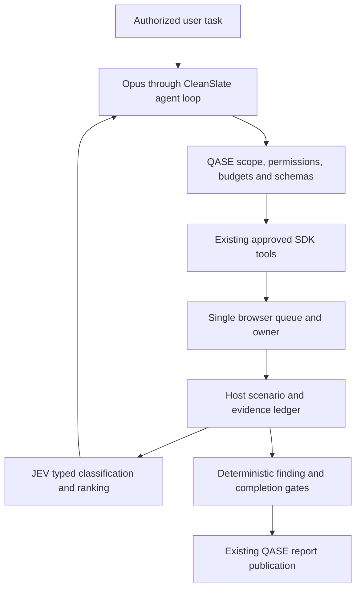

# QASE hybrid QA implementation and verification

23 October 2026

**Status: the SDK streaming-usage blocker is resolved through a QASE-owned
transport adapter; all 13 live gateway checks passed. Hybrid remains disabled
by default; an explicitly approved local test process is enabled (see section
11). It is not approved for production activation.** No deployment, production
migration, production configuration change or SDK package-file edit was performed.

## 1. Repository audit

The [audit and incremental plan](hybrid-qa-implementation.md) identifies the
actual runtime, browser bridge, authentication, permissions, storage, recovery,
telemetry and test entry points. The checkout is a source archive without Git
metadata. Existing modifications were preserved; no reset, replacement checkout
or second agent framework was introduced.

Installed dependencies are `@cleanslate/sdk` 0.1.0 and Playwright 1.62.0. QASE
already had one SDK runtime per run, a host-approved tool registry, account and
tenant controls, browser policy, a secret vault and mode-specific finalizers.
JEV-only mode replaced the SDK run loop; hybrid bypasses that replacement.

## 2. Files created and modified

Created runtime modules:

- `server/hybridConfig.js`: fixed role profiles, disabled admission, key/profile/
  SDK-bound qualification and independent limits.
- `server/hybridModelRouter.js`: SDK chat middleware, JEV transport, cancellation,
  conservative token reservations, output limits and classifier concurrency.
- `server/hybridUsageTransport.js`: authenticated per-runtime loopback adapter
  using the SDK's supported custom-provider base URL, exact SSE usage validation
  and accounting-before-tool-execution guard. No SDK package changes.
- `server/jevClassificationTools.js`: bounded classification and ranking of
  host-validated scenarios or observed scoped routes, uncertainty and caching.
- `server/qaScenarioLedger.js`: scenario states, durable action receipts,
  immutable evidence digests, request-backed assertions and diagnostic checks.
- `server/qaCompletionGate.js`: supported findings, reproduction validation,
  policy attribution and evidence-derived report claims.
- `server/hybridTelemetry.js`: per-role calls, reported usage, latency, active
  execution time and bounded lifecycle events.
- `server/hybridQaRuntime.js`: host integration, one browser queue, repeat
  detection, checkpoints, safe recovery and scoped historical suggestions.
- `server/hybridQaTools.js`: planning, scenario lifecycle and assertion tools.
- `server/hybridPersistence.js`: bounded versioned persistence/hydration.
- `server/hybridGatewayQualification.js`: behavioral gateway qualification.
- `server/hybridBenchmark.js` and `server/hybridBenchmarkFixture.js`: reproducible
  fixture manifest, metrics and loopback-only target.

Other created files:

- `public/hybridQaView.js` and its test.
- `server/hybridArchitecture.test.js`, `hybridGatewayQualification.test.js`,
  `hybridSdk.integration.test.js`, `hybridUsageTransport.test.js`, and
  `hybridBenchmark.test.js`.
- `scripts/qualify-hybrid-gateway.mjs` and `benchmark-hybrid-qa.mjs`.
- `server/postgres/migrations/042_hybrid_qa_state.sql` (authored, not applied).
- `docs/hybrid-qa-implementation.md` and this report.

Modified integration/configuration:

- `server/agent.js`, `qaTools.js`, `browserBridge.js`, `jevBrowserChecks.js`,
  `config.js`, `app.js`.
- `server/store.js`, `localServices.js`, `postgresServices.js`, and
  `server/postgres/runRepository.js`.
- `public/app.js`, `package.json`, and `.env.example` (template only).
- Existing tests: `server/app.test.js`, `browserBridge.test.js`,
  `jevBrowserChecks.test.js`, `store.test.js`,
  `server/postgres/runRepository.test.js`, and `migrations.test.js`.

This usage-compatibility follow-up changes only nine source/document files:
new `server/hybridUsageTransport.js` and `server/hybridUsageTransport.test.js`;
updated `server/agent.js`, `server/hybridConfig.js`,
`server/hybridModelRouter.js`, `server/hybridArchitecture.test.js`,
`server/hybridGatewayQualification.js`, `scripts/qualify-hybrid-gateway.mjs`
and this report. Generated private qualification artifacts are stored separately.

## 3. Architecture

Hybrid retains the SDK's `run` method. The SDK integration test asserts method
identity against the installed runtime prototype. Classifier calls receive
copies of immutable host evidence; they never receive browser ownership,
permissions, executable scripts or confirmation authority. Failed browser
assertions and eligible diagnostic errors are classified by the host, even if
the reasoner does not explicitly request classification.

The hybrid custom-provider base URL now points at a QASE-owned ephemeral
loopback listener. It accepts only authenticated POSTs for the fixed chat path,
fixed Opus model and active model-call scope. The SDK receives a random local
credential; the real account key is attached only by QASE to the fixed HTTPS
gateway. Text remains streamed. Native tool calls are held until the complete
response and exact usage are validated. This is transport middleware, not a
second agent loop, and does not change persisted production configuration.

Native browser tools serialize their execution and drain/suspend preview
capture during browser operations. Existing network/navigation and destructive
action controls stay in place. Hybrid additionally blocks target write methods,
WebSocket connections, form submission and unrestricted execution tools.

## 4. Actual gateway qualification

Reasoner: `drytis/claude-opus-4.7` at
`https://llm.drytis.ai/v1/chat/completions`.

Classifier: `jev-1.13` at
`https://llm.drytis.ai/typesafe/api/alpha/decisions`.

Live harmless probes verified:

| Capability | Actual result |
| --- | --- |
| Basic text | Passed; expected response and returned model |
| SSE streaming | Passed; reconstructed response and requested usage |
| Native tool call | Passed; validated function and arguments |
| Multiple native calls | Passed; two distinct calls and arguments |
| Tool-result continuation | Passed |
| Structured JSON | Passed |
| Image input | Passed; generated red PNG correctly identified |
| Client cancellation/deadline | Passed; transport aborted within the probe bounds |
| Direct gateway usage | Passed |
| Installed SDK loop | Passed; executed tool and continued |
| SDK image attachment/cancellation | Passed in the installed-loop probe |
| JEV typed classification | Passed; unresolved tool failure classified correctly |
| **Usage through the installed SDK stream with QASE adapter** | **Passed; provider totals matched transport accounting** |

### Root cause and smallest supported integration

SDK 0.1.0's `NodeCleanSlateMainService.openAICompatibleChatStream` builds a
streamed request without `stream_options.include_usage`. Its parser already
normalizes `chunk.usage` and emits usage events. `CleanSlateService` consumes
those events; the existing QASE capture hook can observe them when present.
The missing request field, not an unsupported gateway response, caused the
original `sdkUsage` failure.

The low-level SDK transport type accepts `bodyOptions`, but the installed
`CleanSlateNodeAgentRuntime` does not expose arbitrary request-body options or
an inference transport injection option. Its `fetcher` option only applies to
managed-account refresh/entitlement requests. No supported high-level switch
was found. QASE therefore uses the documented custom-provider `baseUrl` seam
and leaves the SDK implementation, global fetch, dependencies and lockfile
unchanged. The adapter adds only `stream_options.include_usage: true` to the
outbound body and retains SDK serialization, message/tool schemas and SSE
parsing.

The adapter validates non-negative safe-integer input/output/total counts,
consistent totals and cached-token bounds. Missing, conflicting, malformed,
wrong-model or truncated responses fail closed. A terminal complete stream is
required before releasing tools. Failed streams and upstream HTTP errors are
not invisibly retried. Validated receipts have unique call IDs; the hybrid
pipeline counts those receipts once and ignores duplicate SDK copies and all
SDK estimates. Explicit cancellation closes the upstream request and drains
the SDK's prefetched read without releasing an unverified tool. Already
verified usage is retained even if downstream delivery is interrupted.

The harmless live installed-SDK probe completed a real tool call and
tool-result continuation, recognized the attached image and verified bounded
client cancellation. SDK-reported totals exactly matched two validated
transport receipts. The required `sdkUsage` check now passes; no estimate was
used to satisfy it. Qualification identity includes transport version
`qase-loopback-usage-v1`, invalidating earlier transport qualifications.

Final rerun: **13/13 passed**, command exit 0. The installed SDK probe produced
two completed usage receipts totaling **10,773 provider-reported tokens**;
SDK and transport totals matched exactly. This total describes that harmless
SDK probe only, not all qualification requests or a QA performance benchmark.
The credential-bound report is under `.qase/qualifications/hybrid/`; log:
`/private/tmp/qase-hybrid-usage-final-qualification.log`.

Recommended upstream improvement: expose an `includeUsage` or provider
`bodyOptions` option through the Node runtime, wire its inference `fetcher`,
and surface a public per-request usage event. A future replacement still
requires the same live qualification; there is no silent transport fallback.

New qualification records are stored under
`.qase/qualifications/hybrid/<profile-fingerprint>.json`, contain no API key,
are bound to the exact effective key/profile/SDK/transport version, and expire after
24 hours. Different account keys receive separate records. An explicit
operator-owned file override is supported; the initial local qualification at
`.qase/qualifications/hybrid.json` remains readable only when its identity
matches. Reports are operator-controlled artifacts, not client input.
The client transport probes cannot establish whether the upstream server stops
billing after cancellation; no server-side cancellation claim is made.

## 5. Implemented behavior

- Explicit QA-only selection: `qaExecutionMode: "hybrid"`. Omission/`legacy`
  retains the configured existing QA path. SQA and Founder keep their existing
  prompts, registries, loops and finalizers.
- Both the disabled feature flag and a successful current qualification are
  required for new hybrid admission. Model/key identity, budgets and degradation
  policy are pinned to the run. A changed flag never converts a hybrid run into
  JEV-only or another model.
- Missing exact reasoner accounting pauses with a typed transport error and
  `usageIncomplete` telemetry. Reserved token budgets remain explicitly
  conservative reservations, never claimed as authoritative provider usage.
- Scenarios record objective, expectation/source, prerequisites, authorization,
  planned/executed actions, assertions, evidence references, reproduction,
  timestamps, uncertainty and coverage. The host derives passed/failed states.
- Findings require intact run-owned host evidence and repeated deterministic
  failure or controlled reproduction. Model-authored expected/actual values
  cannot replace the recorded facts. Relevant policy-blocked resources cannot
  become confirmed target defects.
- Console exception reproduction requires cleared diagnostic observations with
  a successful fresh page open between them. Repeated buffer reads do not count.
- Finalization rejects unfinished scenarios and unsupported pass claims. The
  host builds covered scope, gaps, verdict and authoritative summary. Forms,
  local search, accessibility and authentication retain concrete limitations.
- Native action receipts are checkpointed before dispatch. Unknown outcomes
  become uncertain. Resume verifies browser state, and uncertain mutations
  cannot be automatically replayed after that verification.
- QA macros use the active run cancellation signal, including when queued
  behind preview capture. Responsive cancellation restores the viewport and
  does not start further width checks. An already-dispatched browser primitive
  may finish before cancellation is observed; no atomic remote undo is claimed.
- Repeating an action against unchanged observed state triggers replanning,
  even when fresh but identical snapshots occur between attempts.
- Classifier failures pause by default. Explicit operator configuration may
  allow degraded classification; the degradation remains visible as a gap.
  Reasoner failures/budget exhaustion checkpoint and pause without model
  substitution or automatic action replay.
- The QA Plan and Report panels show model roles, current scenario, states,
  coverage, reported usage, execution time, confirmed/unresolved counts and
  recovery status. Private reasoning is filtered before QASE events.
- Local hybrid commits use the existing atomic JSON writer in strict mode
  before publication; write failures stop dispatch. Legacy commits retain their
  existing behavior. PostgreSQL writes the versioned aggregate to the optional
  new column; old-schema reads remain compatible via composite-row JSON lookup.

## 6. Automated validation

The actual installed SDK/browser integration uses scripted inference and an
isolated loopback target. It verifies the normal SDK loop, multiple tool calls,
one browser context, command/submission denial, POST blocking, automatic
classification, reproduced findings, durable evidence and hidden-reasoning
suppression. It is not a live Opus QA-performance measurement.

Host tests cover qualification identity/freshness, classification schemas/cache,
bounded concurrency, cancelled queue entries, model/browser budgets, timeouts,
evidence tampering, policy false positives, missing credentials, early report
rejection, recovery/non-replay, account-scoped history and actual local/SQL
persistence contracts. Existing authentication, SQA, Founder and legacy JEV
regressions remain part of the full suite.

The original architecture baseline passed 1,890 tests with 26 skipped.
Final usage-compatibility follow-up `npm test`: **1,925 tests; 1,899 passed;
26 skipped; zero failed or cancelled**, 31 suites, 74.93 seconds. Log:
`/private/tmp/qase-hybrid-usage-final-tests.log`.

Final focused `npm run test:hybrid`: **34 passed, zero failed/skipped**,
6.48 seconds. Log: `/private/tmp/qase-hybrid-usage-final-focused-tests.log`.

New tests exercise the real installed SDK over deterministic, fragmented SSE
fixtures: exact token/cached-token validation; native multiple calls and
continuation; accounting before tools; incremental text; malformed, missing,
conflicting or truncated usage; client abort and safe next-call recovery;
transport deadlines; no hidden retries; model/path/authentication isolation;
call-ID deduplication; default-disabled flag; and typed host pause telemetry.
No test uses estimates to qualify exact usage. Existing legacy usage tests
remain unchanged and passed in the full suite.

Source packaging is independently checked with `npm run package --
/private/tmp/qase-hybrid-usage-fix-source.zip`, including generated SHA-256
manifest validation and private-state/dependency exclusion checks. The source
package is a review artifact, not a deployment or production activation.
Packaging exited 0: 676 archive entries, 2,276 KB, with private configuration,
run history and `node_modules` excluded. Log:
`/private/tmp/qase-hybrid-usage-final-package.log`.

`npm run verify` executed syntax and credential checks but exited 1 on four
Git ignore assertions: `.env`, `.qase/config.json`, `node_modules/package.json`
and `qase-share.zip`. This source archive has no Git metadata, so its
`git check-ignore` checks cannot succeed. The existing `.gitignore` contains
the corresponding exclusions. No Git repository was initialized to conceal
this environmental limitation. Log:
`/private/tmp/qase-hybrid-usage-final-verify.log`.

A prior sandboxed browser-only test attempt could not launch Chromium or bind its
loopback server (macOS `EPERM`). The final regression run uses approved execution
outside that sandbox for local test fixtures; the production application is
not restarted or reconfigured.

No standalone lint, TypeScript or build commands are defined by this plain-JS
project. Project verification and source-package validation are used instead;
their individual outcomes are reported rather than called an unqualified
green build.

## 7. Remaining limitations

The SDK usage release gate is now satisfied for the tested key/profile and
transport; qualifications still expire after 24 hours. No complete live hybrid
QA run has been used to claim production readiness or model-quality improvements.
The optional PostgreSQL migration was not applied; new SQL behavior was verified
with repository contracts, not a production database. Optional real-database,
media and alternate-browser qualifications are among the 26 skipped tests.

Hybrid currently operates with public read-only authorization. Authenticated
submissions, business mutations and advanced security workflows need a separately
reviewed authorization/fixture path. Legacy functionality remains available.
No subjective visual or business correctness claim is inferred from DOM presence.

Token reservation bounds are conservative host estimates and are displayed
separately from reported provider usage. The local JSON backend synchronously
rewrites the existing aggregate for strict hybrid checkpoints; PostgreSQL is the
appropriate production storage backend for larger workloads. Performance under
production concurrency and hybrid dashboard layout still need staging review.

## 8. Benchmark

`npm run benchmark:hybrid -- --live` compares the two strategies on the same
loopback fixture and selected checks, with 300 seconds, 180 approved browser
tool calls and two fixture routes. The manifest supplies seeded defects and
negative controls. Metrics distinguish defect-class recall, false discoveries,
FPR over actually executed negative controls, scenario completion, coverage,
latency and reported usage. Unmapped negatives, missing complete cost data and
unmeasured recovery leave the corresponding metrics unavailable.

The live benchmark preflight was attempted and **blocked** by the failed SDK
usage qualification before either strategy ran. Its result contains `runs: []`;
no latency, recall, cost or comparative-quality measurements are claimed.
Historical artifact: `test-results/hybrid-benchmark-1792699727418/result.json`
(exit 2, blocked before the usage fix). The benchmark has not been rerun in
this follow-up: only harmless gateway qualification, not hybrid QA activation,
was requested. The SDK blocker is now resolved, but no new benchmark metrics
are claimed. Current qualification log:
`/private/tmp/qase-hybrid-usage-final-qualification.log`.
Interruption recovery was tested through deterministic qualifications rather
than reported as a measured live benchmark recovery rate.

## 9. Rollback and future rollout

Keep `QASE_HYBRID_QA_ENABLED=false` (the default) and omit `qaExecutionMode` or use
`legacy` for ordinary QA. For JEV-only QA retain the existing JEV provider
configuration. SQA and Founder require no changes.

After any future approved activation, disabling the flag stops new hybrid
admissions. Pause/cancel existing hybrid runs through the normal run controls;
their strategy remains pinned. Do not convert their ledger into a legacy run.
No column drop or data migration is needed for rollback. The nullable column
may remain unused. Never remove existing run history to roll back.

Before any rollout: obtain a fresh successful
`npm run qualify:hybrid-gateway`, review/apply migration 042 in staging through
the normal process, run the live comparison and recovery qualification, then
review cost, latency, false positives and coverage. Enabling production remains
a separate explicit operator decision.

## 10. Production-readiness assessment

The isolated implementation and its host boundaries are reviewable and tested.
The current implementation is **not approved for production activation**.
SDK usage compatibility is verified through the QASE adapter. Live hybrid
benchmarks, staging database verification, dashboard review and production
concurrency validation remain release gates. Default
`QASE_HYBRID_QA_ENABLED` remains false. Existing JEV-only, legacy QA, SQA and
Founder routing does not use this transport.

No SDK upgrade or upstream fix is required to remove the original local
streaming-usage blocker. Operators must still review the new transport,
qualify each effective account key/profile, and explicitly approve any future
activation. No live hybrid benchmark, application restart, deployment,
database migration or production configuration change was performed in this
follow-up.

## 11. Explicitly approved local testing

On 23 October 2026 the user explicitly approved enabling hybrid locally. The
local development server was restarted at `http://127.0.0.1:5174` with
`QASE_HYBRID_QA_ENABLED=true` in that process's launch environment only. The
template default, saved account model settings and production configuration
were not changed. Current qualification is valid (13/13); health and readiness
return HTTP 200. No QA task was automatically submitted.

The QA launcher now exposes an explicit execution-mode choice when the flag
is enabled. Select **Hybrid QA — Opus 4.7 + JEV 1.13** under Coverage, with
**Focused check** and exactly one available browser configuration. This creates
an explicitly hybrid session through the existing authenticated session API;
the environment, scope and selected checks are retained. The review page names
both models. Hybrid multi-configuration dispatch is rejected with guidance,
not silently reduced or sent through legacy matrix execution. Existing QA,
SQA and Founder routes remain available and unchanged.

Launcher changes: `public/index.html`, `public/app.js`,
`public/hybridQaView.js` and its test. Focused launcher/journey/configuration
tests: 72 passed. Full regression suite: **1,900 passed, 26 skipped, zero failed
or cancelled**, 1,926 total, 31 suites, 75.14 seconds. Log:
`/private/tmp/qase-hybrid-local-enablement-tests.log`.
Starting a live QA scenario and reviewing its performance
remain user-controlled next steps; this activation is not a benchmark or
production readiness claim.

To turn off this local override, stop the development server and restart with
`QASE_HYBRID_QA_ENABLED=false` or omit the override. Existing runs retain their
original execution mode.

## 12. Browser-selection regression and launcher UX repair

The hybrid launcher originally validated `browserSupport.engine` against the
compact full-catalog index. That field existed on heavy configuration rows,
but the index intentionally omitted it. Thus an available Focused browser
was incorrectly rejected. The fix carries the host-resolved `executionEngine`
in compact index rows and accepts either explicit compact or heavy-row engine
metadata. No browser-name inference or availability bypass was introduced.

The launcher now shows the exact selected browser/version, device/OS,
execution type and Ready/Checking/Action needed status outside collapsed
customization. Change browser, recommended single-browser selection, missing
metadata refresh, unavailable-browser refresh and catalog retry have explicit
actions. Refresh keeps the URL and focus text. Review/Start use the same
validation reason, preventing the contradictory enabled Review button shown
in the reported screenshot. Focused hybrid selection chooses a compatible
available host-catalog row; legacy matrix selection behavior is retained.

Changed source: `server/qaConfigurations.js`, `public/qaConfigMatrix.js`,
`public/hybridQaView.js`, `public/app.js`, `public/index.html`,
`public/journey.css`, `public/qaJourney.js`; new `public/qaBrowserStatus.js`
and its test. Updated hybrid-view, journey and server catalog tests include
an actual compact-server-index → client-fetch → hybrid-validation contract.
New reproducible UI check: `npm run test:hybrid-launcher` using
`scripts/qualify-hybrid-launcher.mjs` and isolated in-memory services.

Actual validation: **33 targeted tests passed**; full regression suite
**1,908 passed, 26 skipped, zero failed or cancelled** (1,934 total,
31 suites, 75.73 seconds). Logs:
`/private/tmp/qase-browser-ux-targeted-final.log` and
`/private/tmp/qase-browser-ux-full-tests.log`.

The real-dashboard browser fixture passed all seven groups: actual compact
metadata; direct customization; stale-metadata refresh and input retention;
catalog failure/retry; honest unavailable state/recovery; responsive 390px
layout and touch target; review browser/models and explicit hybrid API payload.
It captured the launch request without creating a run. **No live model calls
or target QA tests were made.** Dark/light desktop and mobile screenshots and
the result are in `test-results/hybrid-launcher-ux/` (synthetic fixture data).
Browser log: `/private/tmp/qase-browser-ux-browser.log`.

The corrected local server was restarted with the already approved,
process-only hybrid flag. Health/readiness and the new status module return
HTTP 200. No active saved runs were found before restart. Production
configuration, SDK internals and credentials were not modified. Existing
browser tabs need one refresh to load the corrected frontend/catalog contract.

## 13. Shared-JEV credential startup guard repair

The reported hybrid run failed before any browser action or scenario ledger
was initialized. `ensureRuntime` changed its effective model settings from
JEV to Opus, then applied the legacy shared-JEV destination guard to the
rewritten custom-provider settings. That guard correctly prohibits custom
endpoints for ordinary JEV use, but was checking the wrong configuration at
this point in a qualified hybrid startup.

`server/agent.js` now preserves and validates the original effective credential
source for hybrid startup. Current key/model/endpoint qualification is still
required before the role switch. The Opus transport and JEV client retain
their independent exact upstream endpoint restrictions. The generic guard in
`server/config.js` is unchanged: Settings, legacy QA and arbitrary custom
destinations gain no exception. No key, allowlist, SDK file or production
configuration was changed.

The SDK integration fixture now uses the actual deployment shape: provider
JEV with an environment-backed shared JEV key, rather than an independent
custom key. It reproduced the exact error before the fix and passed afterward.
It also verifies that a qualified hybrid profile cannot launder an invalid
shared-key source pointing at a foreign custom endpoint. Existing browser,
permission, evidence and completion checks still execute through the native
SDK loop.

`npm run qualify:hybrid-startup`, explicitly opted into hybrid in an isolated
process, verified runtime construction with the actual configured shared JEV
key and current 13-check qualification. The SDK loop remained unchanged and a
checkpoint persisted. It did **not** invoke inference, browse a target, create
a saved user run or change account settings. Log:
`/private/tmp/qase-hybrid-shared-key-startup.log`.

Full regression suite: **1,908 passed, 26 skipped, zero failed or cancelled**,
1,934 total, 31 suites, 74.97 seconds. Log:
`/private/tmp/qase-hybrid-shared-key-full-tests.log`. The previous failing
reproduction is retained at
`/private/tmp/qase-hybrid-shared-key-before-fix.log`.

Additional changes: `server/hybridSdk.integration.test.js`,
`scripts/qualify-hybrid-startup.mjs`, its package command, and
`public/hybridQaView.js`/test. A failed pre-runtime session now says
**startup failed**, rather than incorrectly implying qualification is pending.
The local server was restarted with hybrid still enabled; health/readiness
return HTTP 200. No active saved runs were present before restart. The failed
user run and its messages are preserved; reload it and use **Resume** to retry.
No complete live target QA execution is claimed by the startup check.

## 14. Premature interruption: reconcile model reservations with exact usage

### Root cause (23 October 2026)

Run `d8fa3923-48ba-41e4-a1f5-79e30a7a345a` paused after 21.9 seconds with
`HYBRID_MODEL_BUDGET`. Three verified Opus receipts totaled **77,217 tokens**
(76,666 input, 551 output), but the router retained **234,321 conservative
reservation tokens** for those completed calls. Adding a fourth reservation
incorrectly exhausted the 300,000-token cap. Repeated Resume attempts could
not fix the accumulated reservations. This was accounting failure, not a
user cancellation, classifier interruption, or completed QA review.

### Changes implemented

- New `server/hybridBudgetLedger.js`: durable request reservations and exact
  receipts. Budget admission uses provider-reported usage plus **only pending
  exposure**, never cumulative reservations for completed requests. Duplicate
  receipts are idempotent; conflicts, estimates and orphan receipts fail closed.
- `server/hybridModelRouter.js`: settles Opus and independent concurrent JEV
  requests by reservation ID; preserves calls/actual usage across resume;
  enforces actual overruns before releasing tools; retains uncertain exposure
  after cancellation/timeouts; permits explicitly configured classifier
  degradation without retrying unaccounted classifier requests. Classifier
  semaphore release remains reliable even when persistence fails.
- `server/hybridUsageTransport.js`: correlates canonical receipts with their
  QASE reservation. This internal metadata is stripped before SDK invocation
  and never reaches the gateway. Streaming, native tools, continuation and
  the installed SDK loop are otherwise unchanged; no SDK/package edits.
- `server/hybridQaRuntime.js`: routes exact receipts into the ledger and
  publishes pinned budget limits with existing public telemetry.
- `public/hybridQaView.js` and `public/workflowStatus.js`: distinguish actual
  usage from pending reservations and show the real host pause reason instead
  of an unexplained generic pause. Legacy/SQA/Founder guidance is unchanged.
- New `scripts/reconcile-hybrid-budget.mjs`: explicit, offline, local-only
  operator repair. Dry-run by default; refuses active runs/listening server,
  mixed-model legacy logs, incomplete/duplicate/non-exact receipts and totals
  that do not match durable usage. Apply makes a private backup and commits
  through QASE's strict atomic store. No model/browser action, budget reset,
  finding or pass claim is created. Aggregate usage alone is not repair proof.
- New `server/hybridBudgetLedger.test.js`; updated
  `server/hybridArchitecture.test.js`, `server/hybridSdk.integration.test.js`,
  `server/hybridUsageTransport.test.js`, `public/hybridQaView.test.js` and
  `public/runPresentation.test.js`.

### Actual verification and local recovery

The installed SDK + QASE transport + router fixture completed **seven model
calls and six distinct harmless tool actions**, past the former false stop.
It persisted 168,700 **scripted fixture** tokens with zero stale reservations.
These are deterministic regression inputs, **not live model measurements or
a QA benchmark**. Tests additionally exercise true exhaustion, reported
overrun, out-of-order classification, receipt conflicts, cancellation/timeouts,
reconstruction, degraded classification and offline backup/repair safeguards.

Final full suite: **1,920 passed, 26 skipped, zero failed or cancelled**,
1,946 total, 31 suites, 75.58 seconds. Log:
`/private/tmp/qase-hybrid-budget-final-tests.log`.
The focused offline recovery/ledger suite also passed all ten tests.
`npm run verify` executed syntax/secret checks but remains nonzero on four
Git-ignore assertions because this archive has no `.git` directory; this
pre-existing limitation is not a passing verification result.

Qualified startup with the configured account passed, reusing its current
**13/13 live gateway qualification**; it did not rerun paid gateway inference.
Log: `/private/tmp/qase-hybrid-budget-startup.log`.

With no active runs, the idle local server was stopped and the affected run
was reconciled against its three exact host log receipts. The original
77,217 tokens, three calls, all evidence, eight planned scenarios and pinned
limits were retained. Stale reservations are now zero. A private history backup
was retained beside the local store. The run remains paused for explicit
Resume, with browser verification still required; it was **not automatically
replayed or marked successful**.

The corrected local server is listening at `127.0.0.1:5174`; health/readiness
returned HTTP 200. Hybrid remains explicitly process-enabled locally, as
previously approved, while `.env.example` remains disabled by default. No
production configuration, account settings, SDK internals or database changed.

Remaining limits: no complete live drytis.com QA execution or benchmark was
performed for this fix. Genuine budget exhaustion still requires an explicitly
approved new run/budget. Unaccounted older calls without complete exact receipts
remain blocked rather than being forgiven. Production readiness remains subject
to the earlier deployment, persistence and benchmark prerequisites.

## 15. Token efficiency, atomic scenario execution and bounded report closeout

### Precise diagnosis

Run `2207ee1d-7f06-4686-8012-def13931352c` exhausted admission headroom after
seven calls and **219,198 actual provider tokens**. Its reservations were all
settled correctly: this was **not** the earlier reservation leak. The next
request's conservative reservation exceeded the remaining 80,802 tokens.

The run repeatedly sent the legacy QA instructions (including unavailable
hybrid security/media workflows) in both the SDK user envelope and runtime
reminder. Large historical browser inventories further grew the input.
Separate scenario start/check/close calls and an underspecified navigation
call consumed model rounds before coverage could advance. Live reproduction
also exposed repeated unsupported-pass attempts at publication: the gate
correctly rejected them, but did not constrain the model's proposed verdict.

### Implemented fixes

- New `server/hybridContext.js` builds a shorter hybrid-specific operating
  brief and projects only the inference copy of SDK messages. Duplicate host
  context is removed only when its full text matches a runtime reminder in
  this exact run's workspace. User requests, native call/result IDs, images,
  SDK policies and original transcripts are preserved. Old bulky inventories
  compact to intact durable evidence references; assertions and errors remain.
  The saved user's messages measured **76,211 → 27,963 bytes (63% reduction)**
  in the offline projection check. This is message size, not guessed token usage.
- `qa_read_evidence` restores bounded original evidence by scoped ID and page;
  it checks run ownership and evidence digest. Website strings are never
  promoted into host instructions. Original evidence is not deleted.
- Hybrid-only `browser_qa_scenario` wraps the existing fixed check, not a new
  agent loop. Under the existing browser lock it starts one selected scenario,
  executes the approved check, records evidence, then computes its disposition.
  No category-specific assertions means inconclusive, never passed. Category
  mismatches, overlapping scenario ownership, completed-scenario replay,
  uncertain receipts and unverified recovery cannot bypass this boundary.
  Returned host assertion IDs remove an extra ledger-reading round trip.
- Native `browser_qa_check` guidance now explicitly requires a unique observed
  selector and exact observed absolute href for navigation; a prose objective
  is not a URL. Execution validation and browser policy remain unchanged.
- The inference tool schema advertises the current deterministic host verdict
  for `finish_qa_report`. The host still revalidates publication and rejects
  unsupported passes, but the model no longer needs to guess the allowed verdict.
- Before further exploration would consume report headroom, the **same SDK
  loop** narrows to scenario/todo dispositions, evidence-linked findings and
  report publication. Host controls reject browser actions and new scenarios
  during this closeout. Unexecuted scope must remain not-executed/inconclusive
  with a budget reason; nothing becomes a pass automatically. Exact usage,
  calls, independent model budgets and originally selected mode are not reset
  or increased. Truly unverified usage still fails closed.
- The existing hybrid progress view explains budget closeout and coverage gaps.
  Usage logs now name the actual role model instead of labeling every hybrid
  receipt with the source Settings provider's JEV model.

Source changes: `server/agent.js`, `server/browserTools.js`,
`server/hybridQaRuntime.js`, `server/hybridQaTools.js`,
`public/hybridQaView.js`; new `server/hybridContext.js`,
`server/hybridContext.test.js`, `scripts/qualify-hybrid-execution.mjs`;
updated `public/hybridQaView.test.js`.

### Live verification (actual, not fabricated)

The opt-in execution script uses configured live Opus/JEV through the installed
SDK loop against an isolated read-only local fixture. It does not add user
history, change account configuration or browse the user's public target.
The final run **completed in 53.223 seconds**, with:

- Navigation: 3 host assertions, passed.
- Responsive: 6 host assertions, failed on the intentional reproducible overflow.
- Accessibility: 3 host assertions, passed within the fixed accessible-name scope.
- **One reproduced, evidence-linked layout finding**, zero site writes.
- Opus: 8 calls, **156,303 exact provider tokens**; JEV: 1 call,
  **1,577 exact provider tokens**. Both pending-reservation counts ended at zero.
- Host report verdict: **partial**, correctly retaining accessibility/coverage
  limitations rather than claiming a complete workflow pass.
- The original **300,000 Opus-token cap** was unchanged.

Result: `/var/folders/sm/k7zpk1vx3jjdlh10rh7vl5n80000gn/T/qase-live-hybrid-execution-LwKxsz/result.json`.
Log: `/private/tmp/qase-hybrid-context-qualified-live.log` (exit 0).

Earlier development probes are not passing results: context-only execution
hit the budget; atomic execution before verdict guidance hit repeated rejected
publication attempts; another independent live attempt timed out upstream and
retained unverified exposure. These checkpoints/logs were not replayed,
forgiven or presented as successes. The final successful fixture is not a
whole-site benchmark, defect-recall measurement, or proof that the model
gateway never times out.

Configured startup passed with the existing current 13/13 gateway qualification
(reused, not rerun or newly claimed). Health/readiness returned HTTP 200 after
the idle local server restart. Default activation remains false; only the
previously approved local process flag is on. Production, credentials,
authentication, SDK files and production data were not changed.

The user's interrupted run is preserved with its real **219,198 spent tokens**
and original cap. Resume can use the remaining budget for honest closeout;
those already-spent tokens cannot be refunded or silently reset. A fresh run
uses the optimized harness with its full original budget. Timeout/unknown
usage pauses remain intentional safety behavior, not claims of completion.

Final regression validation: **1,931 passed, 26 skipped, zero failed or
cancelled**; 1,957 tests, 31 suites, 75.88 seconds. Log:
`/private/tmp/qase-hybrid-context-release-tests.log`. The new context/control
tests cover duplicate-envelope provenance, original task and image retention,
prompt injection, scoped evidence recovery/tampering, navigation arguments,
atomic serialization, category mismatches, zero-assertion inconclusive results,
uncertain-action replay, ownership changes, deterministic verdict schemas and
closeout browser denial. The installed SDK/browser integration also passed.
Closeout controls are fixture-tested; the successful live three-scenario test
does not establish every possible low-budget/resume closeout path.

`npm run verify` remains nonzero on the same four Git-ignore checks in this
source archive without `.git`; syntax/secret scans ran. No claim of a passing
overall verification command or production readiness is made.

## 16. Evidence-efficient multi-page execution (24 October 2026)

### Audit and root causes

The saved run `6bab66f8-d1a9-455f-8387-c486700c5675` spent 237,762
provider-reported Opus tokens across ten calls, but made only eight browser
actions and executed four of eleven scenarios. Five model calls went into
closeout. Passing accessibility assertions were repeatedly copied into model
results and closeout context; full tool schemas added further repeated input.
The UI displayed three completed cosmetic todos as 100%, not actual scenario
coverage. Existing browser checks were useful, but the SDK loop lacked a compact
way to apply them across explicitly chosen observed routes.

The installed SDK integration fixture also exposed a streaming race: a fast
blocking tool could finish before all tool calls in the response were accepted.
Five streamed finding calls produced only four recorded findings. QASE now
defers native tool dispatch until the entire usage-verified response has been
consumed. Interrupted responses fail closed, and cancellation remains effective.
SDK source, packages and the SDK `runtime.run` implementation are unchanged.

### Implemented architecture and files

- New `server/hybridRouteExecution.js`: explicit, host-validated batches of
  one to three observed route IDs; no independent crawler/agent. Opus selects
  routes and checks. Existing SDK execution, native approvals, browser policy,
  serialization, budgets, activities and durable evidence handle each child
  action. Scope is capped at eight observed pages and eighty scenarios.
  Source inventories/digests and exact candidate provenance are revalidated.
  Functional route priority and cached JEV ranking remain advisory only.
  Navigation actually clicks observed links and checks history; responsive,
  media, accessible-name, safe form/search and console checks execute on each
  chosen page as selected. Interrupted actions/batches are not blindly replayed.
- New `server/hybridSummaries.js`: model-facing summaries contain pass/fail
  counts, bounded failure IDs and evidence references. Original assertions and
  artifacts remain durable. `server/hybridQaTools.js` adds bounded ledger pages
  and evidence views; `server/hybridContext.js` projects useful stage-specific
  tool schemas and instructs multi-page execution. Approved optional tools can
  be exposed with `qa_load_tools`; that grants no new capability or permission.
- `server/hybridQaRuntime.js` and `server/agent.js` integrate these tools and the
  verified-response dispatch barrier with the existing SDK headless executor,
  one browser owner, nested activity receipts and friendly activity labels.
- `server/qaScenarioLedger.js`, `server/qaCompletionGate.js`,
  `server/jevBrowserChecks.js` preserve cross-category failures, require
  intact evidence after persistence, retain two-observation broken-destination
  reproduction, reject unsupported passes and require the bounded observed
  route target before ordinary publication. Budget closeout may publish gaps;
  it does not waive evidence requirements or increase budgets. Evidence hashes
  are checked once per distinct artifact per completion validation, not once
  per repeated assertion; each new validation checks them afresh.
- `server/qaTools.js`: hybrid scenario dispositions, not cosmetic todos, control
  publication. Legacy/SQA/Founder finalization remains on its existing path.
- `server/hybridModelRouter.js`: a validated provider receipt ends the model
  response deadline. A long subsequent browser batch is governed by action and
  overall execution controls, not an already-finished inference timer. Usage
  stays exact and pending/unverified exposure still fails closed.
- `public/hybridQaView.js`, `public/app.js`, `public/planPresentation.js`,
  `public/runCard.js`, `server/store.js`: actual scenario dispositions/counts
  replace misleading todo-based hybrid coverage, including local sidebar
  summaries. Route depth is explicitly not whole-site coverage.
  `public/index.html`, `public/release.json`, `server/uiVersion.test.js` update
  the asset stamp to `20261024-1`; this is not a production deployment.

New fixtures/tests: `server/hybridDepthFixture.js`,
`server/hybridDepth.test.js`, `server/hybridDepth.integration.test.js`,
`scripts/qualify-hybrid-depth.mjs`. Updated regressions:
`server/hybridContext.test.js`, `server/hybridBudgetLedger.test.js`,
`public/hybridQaView.test.js`, `public/runCard.test.js`.

### Actual live validation

The opt-in script ran the configured live Opus and JEV through the installed
single SDK loop on an isolated four-page read-only fixture. It completed in
**74.565 seconds**:

| Measurement | Observed result |
| --- | --- |
| Pages tested | 4 |
| Actual browser actions / SDK browser tool calls | 41 / 41 |
| Recorded scenarios | 28 |
| Confirmed findings | 5 |
| Seeded defect groups detected | 5 / 5 |
| Unexpected finding groups | 0 |
| Remote-data/form writes | 0 |
| Opus | 7 calls; 98,121 input + 3,923 output tokens |
| JEV | 9 calls; 14,054 input + 1,180 output tokens |
| Pending reservation tokens | 0 for both roles |
| Host report verdict | fail |

The five seeded groups were responsive overflow and JavaScript error on
`/docs`, a broken image and missing accessible name on `/contact`, and an
observed 404 destination `/missing`. Fixture group recall was 100% and
unexpected-group rate 0% **on this fixture only**; these are not general defect
recall/false-positive rates or a JEV-only A/B benchmark. No total monetary cost
is estimated. Exact role-level gateway costs, where present, remain in telemetry.

Result: `/var/folders/sm/k7zpk1vx3jjdlh10rh7vl5n80000gn/T/qase-live-depth-RJqZCX/result.json`.
Log: `/private/tmp/qase-deep-live-qualification.log` (exit 0).
For reproduction, run `scripts/qualify-hybrid-depth.mjs` with explicit
`QASE_LIVE_HYBRID_EXECUTION=true`, development mode, local private-network
fixture permission and the hybrid flag. This invokes paid models and requires
a current matching gateway qualification; it never changes account settings.

Startup qualification passed using the current existing **13/13** gateway
artifact, without inference or visiting a target. These gateway protocol checks
were reused, not rerun or newly claimed. The actual SDK/browser integration
also passed with all five finding calls in one response and no cosmetic todos.

Final full regression: **1,943 passed, 26 skipped, zero failed/cancelled**;
1,969 tests across 31 suites in 78.832 seconds. Log:
`/private/tmp/qase-depth-release-tests.log`. Added tests cover stale route
provenance, bounded advisory ranking, SDK dispatch completion/interruption and
cancellation, evidence persistence, cross-category findings, route depth,
ownership/non-replay, stage schemas and truthful UI coverage.
`npm run verify` remains nonzero on the same four Git-ignore checks (`.env`,
`.qase/config.json`, `node_modules/package.json`, `qase-share.zip`) because this
source archive has no Git metadata; syntax/secret scans ran. Log:
`/private/tmp/qase-depth-verify.log`. This is not a passing overall verification
command, nor a live qualification of the 26 skipped optional-service tests.

### Limitations, safety and rollback

This is a bounded, evidence-backed browser review, not unrestricted exhaustive
testing. Form submissions, authenticated workflows, remote-search relevance,
full keyboard/screen-reader testing and business assertions still require
appropriate authorization, credentials, fixtures and expectations. Reaching
eight observed pages does not establish whole-site coverage. Missing scope and
budget exhaustion must remain coverage gaps. Live gateway availability is not
guaranteed. PostgreSQL runtime contracts are regression-tested; no live
production PostgreSQL migration or sidebar qualification was performed.

The old run and its spent usage remain unchanged. A fresh run uses the new
harness; budgets are not silently reset or enlarged. Default
`QASE_HYBRID_QA_ENABLED=false` remains in `.env.example`. Only the previously
approved local process can enable hybrid. Rollback: stop the local process,
restart without that opt-in and select existing JEV-only/legacy mode for a new
run. Existing hybrid runs preserve their originally selected mode and evidence.
No credentials, authentication configuration, SDK internals, production data
or deployments were changed. Production readiness is **not established** by
the controlled fixture.

After checking that no user test was running, the local server was restarted
with the previously approved process-only hybrid flag. Both `/healthz` and
`/readyz` returned HTTP 200, and `/release.json` served UI `20261024-1` at
`http://127.0.0.1:5174`. Existing runs/evidence were preserved; no historical run
was rerun or assigned an improved result.

## 17. Compact suites and interaction-led exploration (24 October 2026)

### Audit of the reported run

Run `71a0e20a-4838-4919-a518-5348272de285` recorded 65 browser
actions, six tested pages out of twelve observed routes, and 51 scenarios.
It spent 180,614 exact Opus tokens and 44,782 JEV tokens. Its 34 passed,
14 inconclusive and three unexecuted scenarios were not 51 distinct user
workflows: the previous host multiplied the category checklist by each page.
Form/search checks repeated even when no eligible control was observed.
Eight of its nine classifier outcomes were environmental noise.

The inventories contained **13 disclosure controls on Solutions and nine on
Pricing**, but the action ledger contained no explicit disclosure, tab or
scroll exploration calls (responsive checks had their own bounded mobile-menu
sample). This establishes a real exploration gap; it does not establish that
the site necessarily contains a specific confirmed defect. No historical result
or spent usage has been edited to imply otherwise.

### Implementation

- New runs pin exploration strategy **version 2**. Each selected category has
  one suite; host-only `startRoute` appends distinct page executions and their
  assertion/action offsets, evidence references, status and uncertainty.
  It cannot replay an attempted page, erase an earlier failure with a later
  pass, or complete a new page using an old page's assertions. Model-visible
  tools cannot directly invoke this continuation method. Existing persisted
  version-one runs keep the version-one strategy.
- `qa_test_routes` still accepts explicit observed IDs chosen by Opus and uses
  the installed SDK executor, normal approval/policy gates, one browser owner,
  unchanged model/browser budgets and durable evidence. There is no second
  agent loop or autonomous crawler. The route count is still bounded at eight.
- Each page is scrolled with the existing fixed check before its inventory is
  evaluated. Navigation suites test observed disclosures and tab selection/
  declared panel visibility, not just load/click/back/forward. Up to twelve
  disclosure trials per page are selected with substantive FAQ/accordion
  priority and browser-budget headroom. Unattempted/blocked controls and content
  beyond the scroll sample remain explicit gaps, not passed assertions.
- Hidden links revealed by a safe disclosure retain evidence-linked source
  reveal instructions. Lazy links retain bounded scroll preparation. After
  reopening the source, QASE recreates the observed prerequisite before the
  actual anchor click; it never masks a failed click with a direct target goto.
  An early fixture failed on hidden/lazy routes; that was retained as a failed
  development check, then fixed and retested, not counted as a success.
- Fixed inventory visibility now excludes descendants hidden by a closed
  native `details` element. Visible standalone field counts avoid mistaking
  controls outside a `form` for absent inputs. Absent forms/search/media are
  inventory-linked coverage metadata rather than repeated empty scenarios.
  A concrete sampled absence can justify an unexecuted disposition, never pass.
- Disclosure trials now use the same local-request isolation as anchor/tab
  trials. Unexpected writes and data requests are blocked; a dependency on them
  suppresses positive/negative assertions and becomes inconclusive. Normal
  rendering dependencies remain subject to the existing browser context policy.
- JEV is called automatically for actual eligible exceptions or failed host
  checks, not every ordinary resource-console error. Classification inputs
  contain bounded failures instead of hundreds of passing assertions. Exact
  usage and fail-closed missing-receipt accounting remain unchanged.
- Repeated identical scenario proposals are idempotent. Batch results summarize
  each suite once and retain all omitted failure IDs via bounded references.
  `qa_read_evidence` adds a paginated `failed_assertions` view so failures after
  hundreds of passes are recoverable without repaying for all the passing text.
- UI Plan rows remain category suites and show per-page trial/gap counts. The
  hybrid panel distinguishes suite execution, route depth and observed control
  trials. Partial categories/pages do not become whole-site coverage. UI stamp
  `20261024-2` invalidates the previous asset cache.

Changed source: `server/qaScenarioLedger.js`, `server/hybridRouteExecution.js`,
`server/hybridQaRuntime.js`, `server/hybridSummaries.js`,
`server/hybridQaTools.js`, `server/hybridContext.js`,
`server/jevClassificationTools.js`, `server/qaCompletionGate.js`,
`server/jevBrowserChecks.js`, `server/jevInteractions.js`,
`public/hybridQaView.js`, `public/index.html`, `public/release.json`,
`package.json`. Fixtures/validation:
`server/hybridDepthFixture.js`, `server/hybridDepth.integration.test.js`,
`server/hybridDepth.test.js`, `server/jevInteractions.test.js`,
`public/hybridQaView.test.js`, `server/uiVersion.test.js`,
`scripts/qualify-hybrid-depth.mjs`. This section updates this report; no SDK
internals, dependencies, production configuration or data migrations changed.

### Live results — actual, bounded, not a general accuracy claim

The opt-in `qualify:hybrid-depth` harness ran real configured Opus/JEV through
the installed SDK loop on a disposable six-page fixture. The task did not
provide the seeded bug list to the reasoner. The observed outcome was:

| Measurement | Actual result |
| --- | --- |
| Completion | done, host verdict fail |
| Duration | 103.930 seconds |
| Pages tested | 6, including menu-hidden and scroll-revealed routes |
| Actual browser actions / SDK browser calls | 58 / 58 |
| Category suites | 7 |
| Confirmed findings / seeded bug groups | 8 / 8 |
| Unexpected groups / fixture writes | 0 / 0 |
| Opus | 8 calls, 119,932 input + 5,626 output tokens |
| JEV | 10 calls, 10,459 input + 1,307 output tokens |
| Pending reservations | 0 for both roles |

In addition to overflow, JavaScript, image, accessible-name and 404 checks,
the eight groups included an inert FAQ, a tab that never selects/reveals its
panel, and a broken fragment on the menu-hidden page. The group recall of
100% and unexpected-group rate of 0% describe this finite fixture only. They
do not prove whole-site recall, absence of false positives elsewhere, or a
performance comparison against the different historical public-site workload.
No overall monetary cost is estimated.

Result: `/var/folders/sm/k7zpk1vx3jjdlh10rh7vl5n80000gn/T/qase-live-depth-CN2lLb/result.json`.
Log: `/private/tmp/qase-suite-live-qualification.log` (exit 0).
The isolated run did not enter user history or alter account configuration.

The final installed-SDK/browser interaction suite passed **7/7** tests in
22.443 seconds (`/private/tmp/qase-interaction-release-sdk.log`). These include
native closed-details visibility, revealed-link provenance, actual safe tab/
FAQ trials, lazy scroll discovery, write blocking and false-positive suppression
when requests were blocked. Focused ledger/context tests additionally cover
version-one continuation, no page/check scenario multiplication, evidence-linked
absence without pass claims, previous-failure retention, no stale-assertion
completion, duplicate-plan idempotence and omitted-failure recovery.

Final full regression: **1,950 passed, 26 skipped, zero failed/cancelled**;
1,976 tests across 31 suites in 90.641 seconds. Log:
`/private/tmp/qase-interaction-final-tests.log`. The final context projection
also passed its ten focused tests (`/private/tmp/qase-interaction-final-context.log`).
`npm run verify` still exits nonzero on the same four Git-ignore assertions
because this archive has no Git metadata. Its syntax/credential scans ran;
there is no passing overall verify or live optional-service qualification claim.
Log: `/private/tmp/qase-interaction-verify.log`.

Configured startup passed with the current existing **13/13** gateway artifact
(`/private/tmp/qase-interaction-startup.log`); those thirteen protocol checks
were reused, not claimed as rerun. Default hybrid activation remains false in
`.env.example`, with only the user's approved local process opting in.

### Local rollout and remaining limits

An active user run was left uninterrupted. After it finished and the server
was confirmed idle, QASE was gracefully restarted at `http://127.0.0.1:5174`.
Health/readiness both returned HTTP 200 and the served UI version is
`20261024-2`. New runs get compact suites; old runs preserve their original
strategy and evidence. The user's reported run is not automatically rerun,
repaired, assigned findings or charged again.

This remains bounded public read-only QA. Business correctness, submissions,
authenticated routes, external workflows, full accessibility and content beyond
the observed/budgeted frontier remain explicitly unverified without additional
authorized requirements/fixtures. No real-site regression run or production
readiness claim is made. Rollback still requires no data deletion: restart
without the process-only hybrid flag and select JEV-only/legacy for a new run.

## 18. Expired qualification recovery and launcher explanation (24 October 2026)

The grayed-out hybrid option was not a disabled local feature flag. The matching
13-check qualification expired on **24 October at 01:55 IST**. The existing
24-hour safety gate correctly blocked new hybrid runs, but the launcher did not
explain why.

All **13 live qualification checks were rerun and passed** using the configured
Opus/JEV gateways and installed SDK: text, streaming, native/multiple tools,
tool-result continuation, structured output, images, cancellation, timeout,
exact usage, SDK loop, SDK usage and JEV. The new record was checked at
**24 October 02:40:01 IST**, expiring **25 October 02:40:01 IST**. The record was
produced by the real qualification script, not manually extended or fabricated.
Log: `/private/tmp/qase-hybrid-renewal.log` (exit 0). No user target was browsed
or test run created for this renewal.

`server/hybridConfig.js` now distinguishes expired qualification from other
qualification failures and returns a credential-free availability summary.
`server/config.js` exposes that summary to the existing authenticated config
endpoint. `public/hybridQaView.js`, `public/app.js` and `public/index.html`
show an accessible status message explaining unavailable qualification rather
than only graying out the option. Generic provider errors/credentials are not
returned. The flag, matching account/model/SDK qualification and all capability
checks remain required; there is no automatic bypass, fallback, extension or
recurring paid qualification job.

Regression additions cover ready/expired/disabled/invalid availability,
credential mismatch, sanitized errors and the launcher explanation.
`server/hybridArchitecture.test.js`, `public/hybridQaView.test.js` and
`server/uiVersion.test.js` were updated. `public/release.json` and the HTML
asset stamp are `20261024-3`.

Focused validation: **55 passed, zero failed/skipped**
(`/private/tmp/qase-availability-focused.log`). Full regression: **1,952 passed,
26 skipped, zero failed/cancelled**; 1,978 tests across 31 suites in 85.867
seconds (`/private/tmp/qase-availability-regression.log`). Actual configured hybrid startup
passed again against the newly issued qualification without inference or target
browsing (`/private/tmp/qase-availability-startup.log`). The local server was
confirmed idle and gracefully restarted with the previously approved
process-only hybrid flag. Health/readiness returned HTTP 200; public config
generation reported `enabled=true`, `qualified=true`, `available=true`,
`status=ready`. Production configuration, SDK internals and user run history
were unchanged. `.env.example` retains its disabled-by-default feature flag.

Users should refresh `http://127.0.0.1:5174/` to load the updated launcher.
Qualification expiry remains intentional: future renewals require successful
compatibility checks, not turning off the safety gate.

## 19. Live interaction visibility and Opus verification (24 October 2026)

### Precise diagnosis

The reported run `27534afe-368b-4ac7-bfcc-67fb3dd56815` was executing,
not idle: during inspection it had already completed five navigation checks,
twenty disclosures, a tab check and five scroll explorations. It subsequently
finished with **98 recorded browser actions and nine Opus calls**. Nothing in
its history, usage, evidence or result was reset or modified.

Three display defects explained the misleading screenshot:

1. Preview timers intentionally skip viewport-mutating QA checks, but rapid
   consecutive checks/batches could starve preview capture between operations.
   There was no guaranteed capture at nested SDK action boundaries.
2. `applyFrame` updated the main URL, but did not redraw the decorative browser
   address bar, which could remain `about:blank` despite a real page image.
3. `hybrid.state` refreshed Plan/Report but not the left progress card, producing
   a stale zero count alongside updated Plan counts. Completed child activity
   captions could also remain in the working strip during later operations.

This diagnosis does not claim that zero findings establish a correct site, or
that a browser action count establishes complete QA coverage.

### Changes

- `server/browserBridge.js`: hybrid preview reads the already-owned Playwright
  page with a bounded, viewport-only JPEG capture. It does not call the SDK
  page-preparation path, resize/scroll the page, disable animations, navigate or
  create another browser. URL/viewport changes during capture cause rejection
  rather than mismatching screenshot metadata. Failed captures retain the last
  honest frame and do not fail QA. Normal timers still skip active checks;
  fixed-check callbacks permit serialized read-only captures at explicit action
  boundaries while retaining check ownership.
- `server/jevBrowserChecks.js`, `server/jevInteractions.js`: optional host-owned
  before/after callbacks around real navigation, disclosure, tab and native
  fragment clicks. They emit actual observed target coordinates and images;
  they do not fabricate cursor movement or dispatch extra clicks. Cancellation,
  authorization, read-only request guards and reproduction checks remain in
  charge. No callback configuration is accepted from model/website text.
- `server/agent.js`: nested SDK tool receipts trigger a boundary capture before
  the next child action. Activity labels identify actual click/history, menu,
  scrolling, tab and geometry checks; atomic scenario summaries use their real
  assertion counters rather than showing only a generic URL.
- `public/app.js`: frame/browser events redraw the browser chrome; hybrid
  coverage events redraw both Plan and progress. Authoritative running activity
  takes precedence over stale captions; completed nested work falls back to the
  active parent instead of remaining stuck on the child caption.
- `public/index.html`, `public/release.json`, `server/uiVersion.test.js` advance
  the UI cache stamp to `20261024-4`. Default hybrid flag and production settings
  remain unchanged.

### Validation actually performed

**Live Opus/JEV through the installed single CleanSlate loop**, on the isolated
six-page read-only fixture:

| Measurement | Observed result |
| --- | --- |
| Outcome | done, host report fail |
| Duration | 141.507 seconds |
| Actual browser actions / SDK browser tool calls | 58 / 58 |
| Distinct tested pages | 6 |
| Preview frames / observed click-target events | 22 / 11 |
| Seeded bug groups detected / unexpected groups | 8 / 0 |
| Category suites / writes | 7 / 0 |
| Opus | 14 calls; 219,515 input + 7,430 output tokens |
| JEV | 10 calls; 10,503 input + 1,316 output tokens |
| Pending reservation tokens | 0 for both roles |

Result: `/var/folders/sm/k7zpk1vx3jjdlh10rh7vl5n80000gn/T/qase-live-depth-XH19dc/result.json`.
Log: `/private/tmp/qase-preview-live-opus.log` (exit 0). This establishes actual
live inference, browser execution and preview delivery on this fixture, not
general defect recall or a latency improvement across different model runs.
The original result's preview path list included a fragment variant of `/deep`;
the harness now reports distinct pathnames, without changing the original data.

The installed-SDK/browser test additionally asserts that frames for `/docs`,
`/contact` and `/missing` arrive **inside the route batch, before the next model
turn**. The interaction suite passed **7/7** in 25.121 seconds
(`/private/tmp/qase-preview-sdk.log`). Focused bridge/agent tests passed
**51/51** (`/private/tmp/qase-preview-focused.log`), including no viewport
mutation, no SDK page preparation, active-check suppression, failure isolation
and action-specific summaries.

New `scripts/qualify-live-preview.mjs` tests the actual dashboard and HTTP/SSE
handlers against disposable injected services: live left-card progress, browser
URL, nested-child labels and return to parent activity all passed with zero
page errors (`/private/tmp/qase-preview-dashboard-focused-r2.log`). It does not
authenticate as a real user, launch a real user run or call models. The broad
older `qualify-dashboard.mjs` attempt failed earlier at its launcher Retry
visibility assumption, before reaching the preview checks; it is not claimed
as passed, and its original source was restored rather than changing unrelated
launcher expectations. The focused fixture's initial missing service-contract
stub was fixed before its passing rerun.

Tests updated: `server/browserBridge.test.js`, `server/agent.test.js`,
`server/hybridDepth.integration.test.js`, `server/studioRunningUi.test.js`.
The latter now explicitly requires authoritative running activity before stale
captions; a full-suite development run flagged its previous ordering assertion.
`scripts/qualify-hybrid-depth.mjs` now records and verifies preview counts,
distinct routes and observed click targets along with evidence/usage results.

### Local status and limits

The user's run finished before any restart. The local server was confirmed
idle and restarted with the existing approved process-only hybrid opt-in.
No user run was replayed, no model substituted, no SDK internals changed, and
no production data/configuration or authentication changed. The current
13-check qualification remains mandatory. Screenshots are observability, not
assertion evidence; slow/failed previews never authorize a retry of a target
mutation. Generic subjective/business workflows still need supported expected
behavior and appropriate authorized fixtures.

Final full regression: **1,954 passed, 26 skipped, zero failed/cancelled**;
1,980 tests across 31 suites in 87.288 seconds
(`/private/tmp/qase-preview-final-tests.log`). `npm run verify` still exits
nonzero on the four existing Git-ignore checks in this source archive without
Git metadata; syntax/secret scans ran (`/private/tmp/qase-preview-verify.log`).
Actual qualified startup passed without additional inference or target browsing
(`/private/tmp/qase-live-execution-startup.log`). After restart, `/healthz` and
`/readyz` both returned HTTP 200 and `/release.json` served UI `20261024-4`.

## 20. Selected-device identity and bounded edge-case workflow (2026-10-24)

### Audit and root cause

The saved runs `71e243b1-35a9-45cf-b5d8-c47d246fe9bf` and
`27534afe-368b-4ac7-bfcc-67fb3dd56815` selected responsive testing. Their
receipts recorded temporary 390/768/1440px samples and restoration to
1440×900. They do not establish a permanent accidental device switch. The
workflow interleaved those samples before selected-device checks, and preview
updates did not distinguish a temporary responsive measurement from the
selected runtime. Existing restoration also did not preserve scroll/focus or
independently reject a changed environment at the next host action boundary.

### Implementation

- New `server/qaViewport.js` pins the host-observed primary viewport and provides
  the bounded sample matrix. `server/hybridQaRuntime.js` verifies this identity
  before and after each browser action. A changed/missing viewport after dispatch
  leaves an uncertain action, no assertion credit, and a recovery pause. The
  host never silently redefines the selected device or replays the action.
- `server/hybridRouteExecution.js` orders version-2 route suites so selected-device
  controls/content checks precede responsive sampling, with diagnostics last.
  Legacy version-1 ordering and JEV-only sample widths remain compatible.
  Fixed check actions must also remain in the operator-selected category scope.
- `server/jevBrowserChecks.js` restores viewport, scroll and the connected
  original focus in `finally`, including cancellation. Restoration failures are
  propagated, not reported as success. Hybrid geometry samples use selected
  width plus 389/390/391 and 767/768/769px (deduplicated). These are adjacent
  representative widths, **not discovered CSS breakpoints or every viewport**.
  The observed mobile menu is still exercised at 390px where eligible.
- The same approved disclosure harness now compares safe native-button/summary
  Enter activation with its observed click behavior. A stable reproduced
  keyboard failure is evidence, even when the click succeeds. Target network
  dependencies remain guarded, restoration uses the already-approved control,
  and unsupported/custom behavior is not inferred as a confirmed defect.
- `server/browserBridge.js` persists `qa.viewport` phase events and annotates
  frames. Reconnects during sampling retain the last selected-device frame.
  `public/app.js`, `public/hybridQaView.js`, `public/index.html` and
  `public/studio-workspace.css` keep that preview stable, suppress mismatched
  sample cursor coordinates, and explicitly label temporary responsive testing.
  Failed restoration has a distinct status. No fake animation/click is added.
- `server/qaCompletionGate.js` records unverified restoration as a coverage gap.
  `server/hybridContext.js` documents this contract for the existing single
  CleanSlate loop. No SDK internals, model, permissions, budget or production
  configuration were changed. UI asset/release stamp is `20261024-5`.
- New `server/qaViewport.test.js` covers identity, before/after dispatch guards,
  wrong-environment pass prevention, cancellation, restoration failure, focus/
  scroll restoration and mouse-success/keyboard-failure reproduction.
  `server/hybridDepth.test.js`, `public/hybridQaView.test.js`,
  `server/hybridDepth.integration.test.js`, `server/hybridDepthFixture.js`,
  `server/uiVersion.test.js`, `scripts/qualify-live-preview.mjs` and
  `scripts/qualify-hybrid-depth.mjs` extend ordering, UI and SDK/live fixtures.

### Validation actually performed

Full regression: **1,962 passed, 26 skipped, zero failed/cancelled**, 1,988
tests across 31 suites in 94.319 seconds
(`/private/tmp/qase-viewport-all-tests.log`). The final focused viewport,
route-depth and UI-version group passed **24/24**
(`/private/tmp/qase-viewport-final-focused.log`). The real installed-SDK fixture
confirmed all **nine** expected defect groups with seven category suites;
its model output is deterministic test input, not live Opus inference.

Actual dashboard/SSE fixture passed with zero page errors, including retaining
the primary image during a temporary 390px frame, showing the sample label,
clearing it after restoration, current progress, browser URL and nested activity
(`/private/tmp/qase-viewport-ui.log`). Qualified startup passed using the
existing 13-check qualification with the original SDK loop and a durable
checkpoint, without additional inference or a user run
(`/private/tmp/qase-viewport-startup.log`).

Live **Opus + JEV**, through the installed single CleanSlate loop and the
updated six-page disposable fixture, also passed (exit 0):

| Measurement | Observed result |
| --- | --- |
| Outcome / host report | done / fail (fixture contains real seeded violations) |
| Execution duration | 171.107 seconds |
| Tested routes / category suites | 6 / 7 |
| SDK browser calls / host action receipts | 59 / 59 |
| Seeded defect groups detected / unexpected groups | 9 / 0 |
| Preview frames / real click-target events | 27 / 12 |
| Final viewport | 1440×900, selected_device, restored true |
| Opus | 12 calls; 210,040 input + 8,290 output tokens |
| JEV | 11 calls; 11,865 input + 1,437 output tokens |
| Pending reservations / writes | 0 for both roles / 0 |

Result:
`/var/folders/sm/k7zpk1vx3jjdlh10rh7vl5n80000gn/T/qase-live-depth-mu9OJC/result.json`;
log `/private/tmp/qase-viewport-live.log`. This measures detection of these
specific nine groups (including the native keyboard activation defect), not
general recall, zero false positives on arbitrary sites, complete test coverage
or a controlled performance comparison. Exact usage remained provider-reported;
no total monetary cost was invented. No user run or external target was used.

`npm run verify` remains nonzero solely on the four existing Git-ignore checks
for `.env`, `.qase/config.json`, `node_modules/package.json` and `qase-share.zip`
in this source archive without Git metadata. Syntax and credential scans ran;
no overall verify pass is claimed (`/private/tmp/qase-viewport-verify.log`).

### Limits and rollback

This is a bounded public/read-only review, not exhaustive testing, model
fine-tuning, real-device qualification or proof that an arbitrary site has no
bugs. Detached native form constraints do not establish application submission
behavior. Credentials, authorized scenarios and expected behavior are still
required for authentication, business rules, writes, comprehensive security,
full accessibility and visual-design correctness. Representative width samples
do not establish every CSS breakpoint. Earlier evidence and selected execution
modes are preserved; failed or uncertain actions are not replayed.

The default flag remains `QASE_HYBRID_QA_ENABLED=false` in `.env.example`.
Rollback is a local process restart without the approved hybrid opt-in, plus
choosing existing QA for new runs; it needs no data migration/deletion. Do not
change the execution mode of saved runs or bypass gateway qualification.

After confirming there were no active saved runs, the local process was
gracefully restarted with the existing process-only hybrid opt-in on
`127.0.0.1:5174`. Health and readiness returned HTTP 200, and release metadata
served `20261024-5` (`/private/tmp/qase-viewport-local-server.log`). No user
run was replayed, no production setting changed and no migration was performed.

## 21. Evidence-based plan completion and explicit agent selection (2026-10-26)

### Findings from the reported run

Run `7577d32a-29f1-467e-b02c-fcf4fdc00c1c` was **JEV-only**, not hybrid:
it has `jev.qa` execution data, no hybrid ledger and no selected hybrid mode.
It recorded 12 distinct routes, 757 assertions and zero failing assertions.
The 20 excluded candidates were blocked analytics requests and their console
counterparts (`ERR_BLOCKED_BY_CLIENT`), not established site bugs. Removing
that exclusion would manufacture findings rather than improve accuracy.

The plan counter was genuinely misleading: every administrative todo was
`completed`, including partial native-form/media/accessibility checks and
unexecuted authentication/search/visual expectations. The saved text already
contained those dispositions, but the counter still displayed 13/13. The
UI now presents this same saved plan as **7/13**, without rewriting history.
This counts fully exercised checks and completed administrative steps, not
seven passed application workflows.

### Changes

- New `public/qaExecutionView.js` centralizes evidence-aware legacy plan
  progress and run-specific model identity. It never infers an old run's model
  from today's server settings. `public/app.js` uses the same counts for the
  left summary and Plan tab. `public/planPresentation.js` understands explicit
  partial, untested, blocked, failed and inconclusive dispositions; administrative
  completion is still not a test pass. SQA/Founder retain their existing paths.
- The launcher requires an explicit agent choice when the hybrid feature is
  enabled. The JEV-only option states that it has no Opus reasoning; review names
  the chosen mode. An explicit selection is remembered for this browser session,
  including when reopening the form. Missing choice blocks both the normal
  action and direct form submission. There is no silent legacy/hybrid fallback,
  no modification of existing execution modes, and qualification remains enforced.
- Run headers now identify JEV-only versus hybrid execution. In
  `public/jevExecutionView.js`, excluded policy/environment observations remain
  available under a separate collapsed group instead of dominating the issue
  list; their raw evidence is preserved as text, not discarded or promoted.
- `server/jevQaRunner.js` retains incomplete/history/readiness checks as
  unresolved execution observations, never confirmed bugs. It cannot treat a
  source document as a tested destination after a failed history transition.
  Its coverage assessment includes subcheck gaps, and failed fixed assertions
  appear as failed plan dispositions. `server/qaTools.js` retains these gaps
  and partial-execution fields in the bounded report evidence.
- The earlier interrupted working-tree improvements are now regression-tested:
  `server/qaRenderReadiness.js` and `server/jevBrowserChecks.js` use control-local
  readiness for safe disclosures, preserve delayed transitions/restoration, and
  do not wait on an unrelated progress meter or off-screen animation. Navigation
  history failures retain the earlier click/HTTP assertions and explicit gaps.
  `server/qaScenarioLedger.js`, `server/hybridQaRuntime.js`,
  `server/hybridRouteExecution.js`, `server/hybridTelemetry.js`,
  `server/qaCompletionGate.js`, `server/jevQaRunner.js`, `server/hybridContext.js`
  and `public/hybridQaView.js` retain unresolved provenance, measured action
  costs and entry/functional-route priority. These are QASE harness changes,
  **not modifications or training of the CleanSlate SDK/model**.
- New tests: `public/qaExecutionView.test.js`,
  `server/qaWorkflowPrecision.test.js`. Existing `server/jevQaRunner.test.js`,
  `scripts/qualify-live-preview.mjs` and
  `scripts/qualify-hybrid-launcher.mjs` test partial-history gaps, honest counters,
  run identity, explicit/remembered selection and actual hybrid dispatch.
  Asset metadata (`public/index.html`, `public/release.json`,
  `server/uiVersion.test.js`) advances to **20261026-1**.

### Validation and boundaries

The installed SDK test confirmed all **nine seeded defect groups**, with seven
category suites and no writes. The added browser tests preserved click/HTTP
facts after a history timeout, rejected unsupported defect confirmation, awaited
a delayed native control and restored its original state. The control-local
readiness fixture measured **108ms**, versus **1,211ms** for page-wide readiness
with an unrelated ticker; this is one diagnostic fixture measurement, **not a
whole-run speedup benchmark** (`/private/tmp/qase-precision-browser-20261026.log`,
4/4 passed). Focused view/JEV regressions passed 15/15
(`/private/tmp/qase-precision-focused-20261026.log`).

The initial live Opus fixture **failed** with `OPUS_TIMEOUT` on its second model
call, before testing pages. Its checkpoint and unverified usage reservation
were preserved; no browser action was replayed, no usage was guessed, no model
substituted and no budget increased. Result:
`/var/folders/sm/k7zpk1vx3jjdlh10rh7vl5n80000gn/T/qase-live-depth-VOMdi5/result.json`;
log `/private/tmp/qase-precision-live-fixture-20261026.log`. A fresh harmless
gateway qualification subsequently passed **13/13**
(`/private/tmp/qase-precision-gateway-20261026.log`); that protocol success does
not erase the earlier execution failure.

One **new isolated fixture run**, not a resume of that uncertain request,
subsequently passed with the same models, budgets and SDK. Actual results:

| Measurement | Result |
| --- | --- |
| Status / host report | done / fail (seeded fixture defects) |
| Duration | 168.613 seconds |
| Tested pages / suites | 6 / 7 |
| Host browser receipts / native SDK browser calls | 59 / 59 |
| Detected seeded defect groups / unexpected groups | 9 / 0 |
| Confirmed findings / writes | 9 / 0 |
| Preview frames / real click targets | 27 / 12 |
| Final viewport | 1440×900, restored true |
| Opus | 14 calls; 220,734 input + 6,964 output tokens |
| JEV | 11 calls; 11,895 input + 1,448 output tokens |
| Pending reservations | zero for both roles in this successful run |

Result:
`/var/folders/sm/k7zpk1vx3jjdlh10rh7vl5n80000gn/T/qase-live-depth-GWfKKt/result.json`;
log `/private/tmp/qase-precision-live-fixture-second-20261026.log` (exit 0).
This is fixture-specific evidence, not proof of defects on `drytis.com`,
general recall or an overall latency improvement. The interrupted run's
unverified reservation remains preserved in its own checkpoint.

Final full regression on the completed source: **1,968 passed, 26 skipped,
zero failed/cancelled**, 1,994 tests across 31 suites in 100.391 seconds
(`/private/tmp/qase-precision-final-rerun-20261026.log`). The final actual
dashboard/SSE fixture passed with zero page errors, including 7/13 legacy
coverage and the visible JEV-only identity
(`/private/tmp/qase-precision-ui-final-20261026.log`). The actual launcher
passed nine checks covering explicit choice, remembered hybrid, exact models/
browser dispatch, unavailable/stale catalog handling and 390px geometry
(`/private/tmp/qase-precision-launcher-final-20261026.log`). These fixtures
create no user runs and call no models. Qualified real SDK startup/checkpoint
also passed (`/private/tmp/qase-precision-startup-20261026.log`).

External `drytis.com` verification was **not executed**: the approval check
rejected it because explicit authorization to test that target and send its
observations to configured model services was missing. No indirect/browser
workaround was attempted. New `scripts/qualify-hybrid-target.mjs` is a reusable
isolated read-only harness, still **unverified on an external target**, requiring
live-model opt-in and a separately authorized exact target origin. It never
creates a user run or changes configuration; approval must precede execution.

`npm run verify` still fails the four pre-existing Git-ignore assertions in this
non-Git source archive (`.env`, `.qase/config.json`, `node_modules/package.json`,
`qase-share.zip`). Syntax/credential scans ran, but overall verify is not passed
(`/private/tmp/qase-precision-verify-20261026.log`). Default hybrid stays false;
only the previously approved local process opt-in is used. No deployments,
migrations, target writes, authentication changes or data deletion occurred.

After checking that there were no active user runs, localhost was gracefully
restarted with that existing opt-in. `/healthz` and `/readyz` returned HTTP 200;
`/release.json` served **20261026-1**
(`/private/tmp/qase-precision-local-server-20261026.log`). Refresh the app and
explicitly select Hybrid for a new Opus/JEV run. Existing JEV-only runs keep
their original execution mode and evidence.

## 22. Live inputs, negative paths and precise prerequisites (2026-10-26)

### Audit of the reported run

Run `3d5ebae0-b45c-4f6c-a8a4-4c967fd1a04c` was genuinely hybrid. Its ordinary
text inputs (`prompt`, `idea`) had no detached native constraints and therefore
zero form assertions. Four email assertions on careers/blog were detached DOM
checks, not real typing. Content/design suites had no approved reference, and
authentication/search had no authorized account/discovered control. These are
different limitations; converting all of them to passed would be false.

Another presentation issue was visible: category status `passed` could coexist
with incomplete page trials. The host retained the page gaps, but the Plan
chip still said Passed. Also, any blocked request during a disclosure discarded
all local DOM evidence, including independently observed positive transitions.

### Implemented

- New `server/qaLiveForms.js` supplies **fixed, bounded synthetic cases** for
  eligible empty text/email/URL/telephone/number inputs, textareas and select
  controls with a restorable empty option. It exercises real fill/select,
  input/change, blur and native invalid events. Cases include empty/whitespace,
  malformed email/URL, syntactically valid examples, Unicode, declared length
  boundaries, numeric min/max/step violations and observed select options.
  At most six fields and eight cases per field execute. This is not exhaustive
  fuzzing or an assertion that arbitrary business input is correct.
- Prefilled, sensitive, credential/payment/permission fields and unsupported
  controls are not edited. Original field values are not put into evidence.
  All entered text is synthetic; `example.invalid` is used for email/URL syntax.
  Each field is restored to its original empty value; original focus/scroll are
  restored. A detached/unrestorable control produces an uncertain action and
  a host recovery pause, not a pass or an automatic replay.
- New `server/qaInputIsolation.js` adds host-controlled per-document egress
  quarantine. It remains active **after the form check returns**, so deferred
  autosaves cannot escape a temporary route guard. HTTP requests from tested
  pages, frames, inherited popups and frameless workers are denied; blocked
  records omit query strings and payloads. Only an exact host-approved document
  navigation, with a real document response/commit, releases that document.
  Browser policy still validates the allowed document; the quarantine never
  grants a destination permission. Blocked-attempt totals remain exact even
  when the bounded detail list is full.
- `server/browserBridge.js` enables live forms only in the protected hybrid
  runtime with HTTP/WebSocket/service-worker protection. Hybrid contexts block
  service workers and out-of-band RTC/WebTransport/SharedWorker construction;
  policy-caused transport errors carry an explicit blocked prefix so they are
  not manufactured target bugs. Legacy QA, SQA and Founder paths are unchanged.
  No SDK package/internal source was edited, and there is still one SDK loop
  and one browser owner. Navigation uses the existing approved bridge wrappers.
- `server/jevBrowserChecks.js` dispatches hybrid forms to the live checker;
  unverified isolation produces a gap without editing fields. JEV-only retains
  its existing detached checker. Native negative failures require matching,
  unchanged declared constraints and repeated evidence. Masks/sanitizers,
  changed contracts, blocked remote validation and unsupported semantics remain
  gaps; there is no claim of successful submission, authentication or recovery.
- Disclosure checks now retain independently observed **passing** DOM facts
  when requests were blocked, but suppress unverified failures and retain a
  dependency gap. Thus blocked telemetry does not erase an observed menu toggle
  or become proof of either a complete remote workflow or a target defect.
- `server/hybridRouteExecution.js` executes read-only/media/responsive checks
  before live inputs, so quarantine cannot contaminate those earlier checks.
  `server/qaScenarioLedger.js` persists subcheck gaps by action/evidence ID;
  passing assertions cannot erase a gap in the same execution. Missing
  content/design references become explicit prerequisite blockers, not passes.
  A passed page trial no longer carries a contradictory default skip reason.
- `server/qaCompletionGate.js` retains valid observations as **partial**, rather
  than marking the whole run blocked merely because its only suite had an
  incomplete subcheck. It excludes gapped page trials from full coverage and
  distinguishes live form evidence from detached checks. Remote/business/
  submission limitations remain mandatory in the final report.
- `server/hybridQaRuntime.js`, `server/hybridContext.js` and `server/agent.js`
  carry the real live-field/case/negative counters through atomic SDK receipts,
  public progress and action summaries. `public/hybridQaView.js` displays
  partial page coverage and live-input counters; it cannot label a gapped
  passed suite as an unqualified full pass. `public/index.html` explains form
  isolation and required content/design references before launch. UI release
  metadata/test advance to **20261026-2**.

### Validation actually performed

New `server/qaLiveForms.test.js` uses real disposable browser/server fixtures:
live input events, negative paths, numeric boundaries/steps, textarea/observed
select options, untouched private/prefilled controls, no submission, delayed
HTTP autosave denial after return, approved-document release, popup inheritance,
cancellation, detached-control restoration failure, and a reproduced invalid
validation-function result validated through the host evidence ledger.
It also proves that blocked telemetry retains local menu passes without
confirming unverified failures. Existing `server/hybridArchitecture.test.js`
and `public/hybridQaView.test.js` test reference blockers, uncertain restoration,
gap preservation and partial route progress. The installed-SDK integration test
now explicitly requires real live-field and negative cases, not detached-only
form evidence. `scripts/qualify-live-preview.mjs` verifies the same live counts
and partial status over actual HTTP/SSE UI updates.

Focused browser/observation regression passed **17/17**
(`/private/tmp/qase-input-observations-final.log`). Earlier focused architecture/
input/view regression passed 40/40 (`/private/tmp/qase-input-final-focused.log`).
A development regression caught and led to the partial-vs-blocked completion
fix. One numeric fixture development attempt timed out; its isolated rerun
passed in 2.004s without changing assertions/timeouts. No proven causal claim
is made about that transient timeout.

Actual **Opus + JEV through CleanSlate**, on the disposable six-page fixture:

| Measurement | Observed result |
| --- | --- |
| Outcome / report | done / fail (fixture contains seeded defects) |
| Duration | 167.252 seconds |
| Browser receipts / native SDK browser calls | 59 / 59 |
| Pages / category suites | 6 / 7 |
| Seeded defect groups / unexpected groups | 9 / 0 |
| Live field trials / input cases / declared-negative cases | 1 / 4 / 3 |
| Input value restored / submissions / writes | true / none / 0 |
| Final viewport | selected 1440×900, restored true |
| Opus | 14 calls; 227,674 input + 7,293 output tokens |
| JEV | 11 calls; 11,884 input + 1,445 output tokens |
| Unverified reservations | zero for both roles |

Result:
`/var/folders/sm/k7zpk1vx3jjdlh10rh7vl5n80000gn/T/qase-live-depth-br9TII/result.json`;
the adjacent `checkpoint.json` contains the live `formTesting` receipts.
Log `/private/tmp/qase-live-input-opus-fixture.log` (exit 0). The live model
fixture's input was an email field; other input types were verified by real
browser fixture tests, not claimed as exercised on an external site.
`scripts/qualify-hybrid-depth.mjs` now reports/asserts live-input receipts in
future runs. This fixture measures neither general defect recall nor whole-site
coverage; no external `drytis.com` test was performed in this change.

Qualified SDK startup passed against the existing current **13-check** gateway
qualification (`/private/tmp/qase-input-startup.log`). Its loop and checkpoint
were verified without a target run. The default hybrid flag remains false;
only the previously approved local opt-in is used. There is no production
deployment/configuration change, SDK internal edit, migration or target write.

### Remaining scope

No form is submitted and no Enter/login/password attempt is made. Remote
validation, side effects and persisted business state require an explicitly
authorized test environment/scenario. Local validation messages/caches are not
claimed to be a complete restored application state. The quarantine can make
network-dependent features untestable in this safe mode; those gaps stay visible.
Correct copy and visual comparisons still require approved reference content/
design criteria and supported comparison tools. Credentials and account-based
negative scenarios must use the authorized test-account path, not guessed
values. Unsupported controls and input combinations beyond the bounded matrix
are explicitly outside this sample; **all aspects/all edge cases are not claimed**.

### Final release checks and local handoff

Final exact-source regression: **1,980 passed, 26 skipped, zero failed or
cancelled**, 2,006 tests across 31 suites in 102.789 seconds
(`/private/tmp/qase-input-release-tests.log`). The final dashboard/SSE fixture
passed with zero page errors, including a passed suite with a page gap showing
partial/0-of-2 coverage and actual live-input counters
(`/private/tmp/qase-input-release-ui.log`). The desktop/mobile launcher fixture
passed its explicit-mode/catalog/browser dispatch checks
(`/private/tmp/qase-input-release-launcher.log`). No user run was created by
those UI fixtures and they invoked no models.

`npm run verify` still exits nonzero on the four existing Git-ignore checks in
this non-Git source archive: `.env`, `.qase/config.json`,
`node_modules/package.json`, `qase-share.zip`. Syntax and credential scans ran;
overall verify is **not** claimed as passed
(`/private/tmp/qase-input-release-verify.log`).

No active user run was present at handoff. Localhost was gracefully restarted
with the existing approved process-only hybrid opt-in; health/readiness returned
HTTP 200, hybrid availability was ready, and release metadata served
**20261026-2** (`/private/tmp/qase-input-local-server.log`). No saved run was
replayed or converted. To roll back activation, restart without the local
hybrid opt-in and explicitly select existing JEV-only QA for new runs; that
path retains its detached checker. No migration or evidence deletion is needed.

## 23. Classifier receipt recovery and hybrid-only launcher (2026-10-27)

This section supersedes the earlier agent-selection and automatic-results UX.
The user explicitly requested hybrid for new QA runs, preservation of existing
logic, clearer recovery, gentle button colors and user-controlled results
navigation. Changes were made in this source archive without replacing the SDK,
editing dependencies, deploying, migrating data or replaying a user run.

### Audit, root cause and limits of the diagnosis

Run `1b497406-c8a9-4f3a-ad5f-7e0878caed99` has four settled reasoner calls,
two settled classifier calls and a third classifier reservation marked uncertain.
The third classification failed after approximately 152 ms. Its 10,241 reserved
tokens are **unverified exposure**, not measured token usage. The prior telemetry
recorded only `JEV_UNAVAILABLE`; it retained neither an HTTP status nor a failure
stage. There is no third usage receipt in the saved run or inspected local host
log. Its original upstream failure cannot therefore be attributed specifically
to rate limiting, connectivity or response validation.

Two source-level receipt-loss paths were independently identified and reproduced:

1. The router reserved classifier budget before the client validated the question
   schema and the exact 200 KB wire limit. A wholly local failure could leave an
   uncertain reservation even though no request was dispatched.
2. The client validated answers and checked cancellation before exposing usage.
   A successful response with exact usage but invalid answers, or cancellation
   after receipt parsing, could discard legitimate accounting evidence.

These paths are fixed and regression-tested. They are not claimed as proven
causes of that historical third failure. The existing run remains safely paused;
no unknown receipt was fabricated, forgiven, estimated, or replayed. Repeated
Resume now produces an actionable recovery state without restarting execution.
Recovering that historical reservation still requires a matching exact provider
receipt and operator reconciliation; the existing legacy-only repair script
cannot automatically repair mixed-role, per-request unknown usage.

The screenshot's long timer also included paused wall time after repeated
continuations. The active telemetry recorded 137,706 ms. Hybrid's header timer
now uses the measured active duration, freezing at 02:17 across reloads.

### Implemented architecture and workflow

- `server/jevClient.js` exports shared wire-payload validation. Exact safe-integer
  usage, total consistency and non-estimated provenance are validated separately
  from answer validity. A per-call receipt callback persists usage before answer
  validation or late cancellation. The endpoint/model allowlist is unchanged.
- `server/hybridModelRouter.js` snapshots observations and question schemas,
  validates before reserving, and settles the matching reservation through the
  receipt callback. Only provably undispatched calls release their reservations
  without a usage receipt. Failed dispatched calls still fail closed. Safe
  diagnostics persist failure code, stage, HTTP status when available and whether
  usage was verified; upstream bodies and credentials are excluded.
- `server/hybridBudgetLedger.js` retains an explicit `not_dispatched` terminal
  record. It cannot accept a provider receipt for that record and does not treat
  it as billable usage or uncertain exposure. Settled receipt idempotency and
  unknown dispatched exposure protections remain intact.
- New `server/hybridRecoveryGate.js`, integrated into `server/app.js`, rejects
  unreconciled resumes before appending messages, initializing the SDK or opening
  a browser. `server/hybridQaRuntime.js` checks the router before beginning a
  continuation and exposes a safe recovery reason through public progress.
  Explicitly pinned classifier degradation policy is respected; it was not
  enabled for the affected run.
- `public/index.html` and `public/app.js` replace the agent selector with a
  read-only hybrid readiness card. Old session-storage choices cannot select
  another agent. New launcher requests explicitly use hybrid. With the feature
  enabled, omitted execution mode in the session API also defaults to hybrid
  (`server/hybridConfig.js`). Existing run identities and explicit legacy API
  rollback remain supported. Unqualified/unavailable hybrid blocks launch with
  an explanation; there is no silent fallback.
- Completion no longer switches the route, mobile workspace, or selected QA
  detail tab to results. The guidance button and mobile Results control open
  results explicitly. Back returns to the run without bouncing to results.
- `public/workflowStatus.js` explains missing receipts and exhausted budgets in
  plain language. Resume is disabled for conditions that cannot be cleared by
  retrying; saved progress remains accessible. User-paused runs stay resumable.
- `public/brand.css` adds scoped pale blue actions and green/amber status accents,
  visible focus outlines, and a readiness card using existing theme/layout tokens.
  The dark/light desktop and 390 px mobile layouts were inspected. Release/UI
  metadata is **20261027-1** (`public/release.json`, `server/uiVersion.test.js`).

New tests: `server/jevUsageRecovery.test.js`, `public/workflowRecovery.test.js`.
Additional changed tests: `server/app.test.js`,
`server/hybridArchitecture.test.js`, `public/productUiPromotion.test.js`,
`public/studioHierarchyContract.test.js`, `public/runPresentation.test.js`.
The prior automatic-results expectations were intentionally updated to match
the user's requested behavior. Actual browser/SSE fixtures verify the behavior,
in addition to those source contracts.

### Validation actually executed

- Full regression: **1,992 passed, 26 skipped, zero failures/cancellations**;
  2,018 tests, 31 suites, 99.503 seconds
  (`/private/tmp/qase-recovery-final-all-tests.log`).
- Focused final accounting/recovery regression: **21/21 passed**
  (`/private/tmp/qase-recovery-receipts-final.log`). This includes exact receipts
  with malformed answers, local pre-dispatch failures, late cancellation,
  conservative HTTP-429 handling, missing/fractional/unsafe/estimated usage,
  checkpoint failure, recovered exposure, and existing-mode/degradation policy.
- Server/navigation/architecture checks: **96/96 passed**
  (`/private/tmp/qase-recovery-final-focused.log`). The HTTP resume test verifies
  a 409 response with no messages, runtime work, browser work or run mutation.
- Live configured gateway: **13/13 qualification capabilities passed**, including
  text, streaming, tools, multiple calls, tool continuation, structured responses,
  images, cancellation/timeouts, native SDK loop, SDK exact usage and JEV
  (`/private/tmp/qase-recovery-gateway.log`). Qualification was renewed locally.
- `scripts/qualify-hybrid-launcher.mjs`: **10 workflow checks passed**, including
  hybrid-only dispatch, stale browser metadata recovery, unavailable catalog,
  desktop/dark/mobile rendering and unavailable-gateway blocking without fallback
  (`/private/tmp/qase-recovery-launcher-final.log`).
- `scripts/qualify-live-preview.mjs`: passed with zero page errors. Actual HTTP/
  SSE updates verify saved-progress guidance, disabled unsafe Resume, timer
  freezing after reload, completion preserving desktop/mobile route/view/tab,
  explicit Results and Back, honest historical JEV-only coverage, live input
  counters and selected-device preview stability
  (`/private/tmp/qase-recovery-preview-final.log`).

The real CleanSlate + Opus + JEV loop also completed the disposable six-page
fixture in **165.962 seconds**, without interruption:

- Seven suites; 59 SDK/host browser actions; six observed pages tested.
- Nine confirmed findings matching all nine seeded defect groups; zero unexpected
  groups. These are fixture measurements, not a whole-web recall guarantee.
- One live field, four cases including three declared-constraint negative cases;
  fields restored, no submission, **zero writes**.
- Selected 1440×900 viewport restored; 30 preview frames and 12 visible click
  targets recorded.
- Opus: 12 calls, 195,463 input / 6,315 output tokens. JEV: 11 calls,
  11,878 input / 1,441 output tokens. All 23 reservations settled; none pending.
- Final report correctly says `fail` because the fixture contains real defects;
  the run lifecycle is `done`. No comparative production benchmark is claimed.

Fixture result:
`/var/folders/sm/k7zpk1vx3jjdlh10rh7vl5n80000gn/T/qase-live-depth-Brg8d3/result.json`.
Log: `/private/tmp/qase-recovery-live-depth.log`.

### Local handoff, rollback and readiness

No user run was active before the verified local process was gracefully
restarted. Localhost serves UI **20261027-1**, HTTP 200, with process-only
`QASE_HYBRID_QA_ENABLED=true`; the configured hybrid profile reports `ready`.
Public `/api/config` correctly returns 401 without authentication. No production
configuration or `.env` was changed. `.env.example` still defaults to `false`.

To roll back local activation, stop the idle local process and restart without
the opt-in. New launcher runs will explain hybrid unavailability rather than
silently changing agents. Explicit `qaExecutionMode: legacy` API callers and
previously created legacy/JEV-only runs retain their execution path; restoring
the prior UI bundle is an alternative operator rollback. No migration, budget
reset, history conversion or evidence deletion is required. SQA and Founder
execution paths remain unchanged and are covered by the existing regression suite.

This is a locally qualified reliability/UX improvement, **not a production
deployment or a claim of universal production readiness**. Genuine unknown
usage, permission failures, exhausted budgets and uncertain browser actions must
still stop safely. The original run's missing receipt remains unresolved. The
non-Git archive also retains four pre-existing `npm run verify` ignore-check
failures (`.env`, `.qase/config.json`, `node_modules/package.json`,
`qase-share.zip`); syntax/credential scans ran, but overall verification is not
claimed as passed. No external user target was rerun in this validation.

## 24. Route capacity and budget-closeout consistency (2026-10-27)

### Exact diagnosis

The saved run `d54866d9-1f36-4dc7-82b7-471b90c8c674` tested six of fifteen
observed routes, using two successful three-route batches. Its next three-route
request was rejected wholesale because `6 + 3 > 8`, although **two page slots
were still usable**. The model then spent additional turns disposing scenarios
and attempting publication instead of exercising those two slots.

The depth rejection timestamp is `1793045548705`; the host entered budget
closeout at `1793045548844`, **139 ms later**. The model's later explanation
conflated that earlier rejection with the new closeout policy. Publication
already waived unmet depth during host closeout, but the earlier error remained
in model-facing history and the remaining capacity was not accurately reflected
in batch suggestions or schemas. Retrying unavailable frontier/batch tools then
wasted more turns. A subsequent user instruction on the completed closeout run
only republished the same report.

This was not hard budget exhaustion: the saved totals were 54/180 browser
actions, 15/60 reasoner calls, 224,169/300,000 measured reasoner tokens and
240,140/900,000 ms active execution. The earlier closeout was the host's finite
report-headroom reservation, which remains a legitimate safeguard. No budgets,
accounting receipts, historical dispositions or saved reports were reset.

### Implementation

- New `server/hybridRoutePolicy.js` is the shared authority for attempted/tested/
  pending routes, target, remaining slots, next batch size and publication phase.
  Failed/interrupted attempts consume page capacity without being credited as
  tested or passed. Its supported check list is shared with route execution.
- `server/hybridRouteExecution.js` validates **every requested route and its
  provenance**, then executes only the fitting ordered prefix of a valid batch.
  A request for three routes with two slots executes two and explicitly returns/
  persists the third as deferred. Unexecuted routes remain pending; they cannot
  become assertions or coverage credit. Zero-capacity requests return a clear
  typed result without browser actions. Suggestions and subsequent candidate
  batches respect available capacity; advisory JEV ranking is skipped when
  exploration cannot proceed.
- `server/hybridContext.js` advertises the current batch capacity in the native
  tool schema and withholds publication while executable depth is still pending.
  During host closeout it exposes the report again, explicitly supersedes stale
  pre-closeout depth errors in the **inference copy only**, and explains that
  missing depth must be reported as gaps. Only unfinished scenario IDs are
  offered for closeout; the disposition tool is omitted when none remain.
  Durable SDK history and the host's rejection of terminal scenario relabeling
  are preserved. No second agent loop or SDK modification was introduced.
- `server/qaCompletionGate.js` uses the same phase/capacity policy. It retains the
  executable-depth requirement before closeout, refuses unsupported passes, and
  includes the exact attempted/target shortfall in closeout coverage gaps.
  `server/qaTools.js` returns a typed depth blocker with actionable capacity.
  Unsupported-only scope (for example authentication without an authorized
  workflow) can publish an honest blocker rather than being forced into route
  checks that do not support its selected scope.
- `server/hybridRecoveryGate.js` rejects new execution instructions on a completed
  budget-closeout report **before** adding messages, starting the runtime or
  spending another model call. It explains that remaining scope needs a new test;
  an unpublished closeout checkpoint can still be resumed to finish reporting.
  `public/workflowStatus.js` gives the same plain-language guidance.
- `server/hybridQaRuntime.js` exposes safe capacity/phase metadata.
  `public/hybridQaView.js` distinguishes attempted pages from tested pages,
  displays the target and explains why closeout cannot demand further exploration.
  UI/release metadata and `server/uiVersion.test.js` advance to **20261027-2**.

Updated automated tests: `server/hybridDepth.test.js`,
`server/hybridContext.test.js`, `server/app.test.js`,
`public/hybridQaView.test.js`, `public/workflowRecovery.test.js`.
New `server/hybridRouteCapacity.integration.test.js` runs the installed SDK and
real disposable browser pages with deterministic model mocks. It verifies both
six-plus-three reaching eight pages, and host budget closeout at six pages
publishing one partial report with no depth/tool rejection loop. All browser
children use the existing approved SDK executor and durable evidence ledger.

### Validation and scope of claims

The new boundary/publication browser cases plus the existing nine-defect SDK
integration passed **3/3** (`/private/tmp/qase-depth-capacity-sdk.log`). The two
boundary cases took 20.224s and 15.112s respectively. The first uses eight actual
browser pages and leaves one observed page pending; the second uses six and
leaves three pending. Each publishes once, with zero rejected route/report tools,
zero writes and unchanged eight-page limits. These are deterministic model mocks,
not live Opus benchmark measurements.

Focused policy/context/view/version checks passed 40/40; the final scope/recovery
policy checks passed 41/41 (`/private/tmp/qase-depth-capacity-view.log`,
`/private/tmp/qase-depth-capacity-policy-final.log`). HTTP/recovery checks passed
53/53 (`/private/tmp/qase-depth-capacity-resume.log`). The real dashboard/SSE
fixture passed with zero page errors and preserved explicit results navigation
(`/private/tmp/qase-depth-capacity-ui.log`).

The configured **live Opus + JEV + CleanSlate** loop also finished the existing
six-page defect fixture in **176.062 seconds**: seven suites, 59 SDK/host browser
actions, all nine seeded defect groups confirmed, no unexpected groups and zero
writes. Live input evidence records four cases, including three negative cases,
with restoration and no submission. The selected 1440×900 viewport was restored.
Opus used 15 calls, 241,690 input / 7,601 output tokens; JEV used 11 calls,
11,882 input / 1,446 output tokens. Both roles ended with zero reservations.
Result: `/var/folders/sm/k7zpk1vx3jjdlh10rh7vl5n80000gn/T/qase-live-depth-vQN2ZC/result.json`;
log: `/private/tmp/qase-depth-capacity-live.log`.

That live run recovered from one malformed model tool-argument response and
rejected attempts to re-close seven terminal suites. The final closeout schema
restriction addresses the latter with deterministic SDK/context verification;
another live model run was not used to claim a before/after latency reduction.
No comparative performance or whole-platform recall guarantee is asserted.

The eight-page limit and all original model/action/time/permission budgets remain
intact. Larger platforms, private workflows, credentials, unsupported controls
and missing reference specifications can still leave explicit coverage gaps.
This fix uses available slots correctly; it does not promise exhaustive testing
or turn unexecuted scope into passes. The user's external target was not rerun,
and its historical report was not rewritten or automatically resumed.

### Final release checks and local handoff

The release regression passed **2,001 tests**, with 26 skipped, zero failures or
cancellations: 2,027 tests across 31 suites in 115.990 seconds
(`/private/tmp/qase-depth-capacity-release-tests.log`). After the final closeout
tool restriction, focused context/depth and both installed-SDK browser boundary
cases passed **31/31** in 35.460 seconds
(`/private/tmp/qase-depth-capacity-closeout-final.log`). No completed category
was relabeled to avoid those errors.

The local process was verified idle before a graceful restart. Localhost serves
**20261027-2**, root and health return HTTP 200, and hybrid reports `ready` with
the existing process-only opt-in (`/private/tmp/qase-depth-capacity-local-server.log`).
No production configuration, default activation flag or stored run was converted.
The full gateway protocol qualification was not repeated for this routing-policy
change; the existing qualified transport and fixed model profiles are unchanged.

`npm run verify` still fails the four pre-existing Git-ignore assertions in this
non-Git source archive; no overall verify pass is claimed
(`/private/tmp/qase-depth-capacity-final-verify.log`). Rollback needs no data
migration: restore the prior policy/context/executor/UI sources and restart an
idle local process; existing run modes, pinned budgets and evidence remain intact.

## 25. Startup and refresh stay on the run workspace (2026-10-27)

The previous completion fix missed an independent branch in
`public/app.js:bootWorkspace`: restoring the remembered/latest completed run from
the root/runs route still selected `results` based on its `done` status. It now
restores `run` regardless of completion. A failed restoration also no longer
overrides the runs-list fallback with the run that failed to load. Explicit
Results actions and direct Results URLs retain their normal routing behavior.

`scripts/qualify-live-preview.mjs` now verifies root entry and refresh on both
1440px desktop and 390px mobile with a remembered completed run, no remembered
run, and a stale remembered ID. It also verifies the `?run=` launch handle,
explicit Results navigation/refresh and Back. The actual dashboard/HTTP/SSE
fixture passed with zero page errors
(`/private/tmp/qase-startup-navigation-ui.log`). Targeted router, product UI,
hierarchy, recovery and asset-version tests passed **32/32**
(`/private/tmp/qase-startup-navigation-tests.log`). The source contract now
rejects both spellings of the status-based startup redirect, including optional
chaining, which the prior source test missed.

`public/index.html`, `public/release.json` and `server/uiVersion.test.js` advance
to **20261027-3** to refresh cached clients. The existing local static server
serves the updated code and health returns HTTP 200; a server restart was not
needed. No model calls, user-run execution, budget changes or stored-run changes
were involved. Results appear automatically only when the user explicitly opens
a Results URL; ordinary startup and run refresh do not select them.

## 26. Secure access questions and run continuity (2026-10-27)

Root cause: the hybrid inference tool allowlist omitted CleanSlate's native
`ask_question`. Its public-only browser policy also prohibited every sign-in
POST even after the existing secure vault form supplied credentials. Merely
changing the model prompt could not authorize or execute authenticated access.

The native question is now advertised. An observed password form blocking
requested authenticated scope requires a secure test-account/public-only choice
before publication while exploration budget remains. Closeout does not collect
credentials that it cannot use. The authenticated session-owner endpoint validates
explicit secure-form consent, target origin and supported credential fields
before storing secrets and recording a one-attempt host grant. Chat and website
text never produce that grant. A public-only answer is remembered; an explicit
later owner request can reopen the question, without itself authorizing login.

`server/hybridAuth.js` implements a fixed `browser_authenticate` operation using
the SDK-owned browser. It reopens the observed same-origin sign-in page, requires
a unique native form, username/password and safe submit control, checkpoints
before typing, then permits exactly one credential-bearing sign-in POST from
that page. Other writes, account creation, cross-origin sign-in, autosaves and
credential-bearing URLs remain blocked. Preview capture is held under the same
serialized browser-operation lock. Native fill/type cannot inject vault
placeholders or bypass the credential operation. Provider/model APIs are unchanged.

Successful access requires the password form to disappear plus either the
user's expected same-origin URL or a visible sign-out control. Access evidence
does not pass the authentication suite. Unknown dispatch is durably marked
uncertain, pauses execution and cannot be automatically replayed, including
after restart or a later public-only choice. Private route inventories carry
a host-owned access context: a public observation at the same URL cannot stand
in for its signed-in content. Evidence and existing budgets are preserved.

Bounded run memory includes the original task, latest noncredential instruction
and durable access decision; model context caps operator-memory text and retains
the existing evidence-ID recovery mechanism. Raw and URL-encoded known secrets
are redacted. The credential UI requires consent and preserves fields/question
when validation fails; Skip login remembers the public-only decision. UI assets
advance to `20261027-4`.

Actual validation:

- Full `npm run verify`: **2,033 passed, 26 skipped, zero failed**, 2,059 tests,
  31 suites. Syntax, private-path ignore and credential-signature checks passed
  (`/private/tmp/qase-hybrid-auth-final-verify.log`). The earlier archive-only
  Git-ignore failures are resolved by restoring repository metadata against
  the original GitHub baseline without replacing working files.
- Installed CleanSlate/browser fixture asked, paused and resumed, submitted one
  synthetic test-account sign-in, inspected the dashboard, blocked autosaves,
  duplicate login and credential-bearing URL, and rejected replay. Inference
  was scripted; no real account or live model was used.
- Unit/HTTP regressions cover consent, unauthorized/foreign origins, unsupported
  fields, missing access, durable decisions, context bounds, signed-in evidence
  separation and cancellation after dispatch. Existing JEV-only, legacy, SQA
  and Founder regression paths passed in the full suite.
- Actual dashboard/HTTP/SSE fixture passed secure consent, validation-error
  recovery, Skip login, prior desktop/mobile navigation and zero page errors
  (`/private/tmp/qase-auth-handoff-ui.log`). CI now repeats this fixture.

Limitations: automated sign-in currently requires a native username/password
form and same-origin credential POST on a recognized sign-in endpoint. SSO/MFA,
cross-origin auth APIs, multi-step/custom forms, token refresh writes and general
authenticated mutations require separately designed authorization support.
No claim is made that every production target's login protocol is compatible.
Exact gateway usage, budget, scope and evidence gates remain mandatory.

## 27. Production source handoff (2026-10-27)

Release `qase-2026-10-27-hybrid-production-r1` preserves GitHub main
`82911f8db54f7eb3efeb9b45e96d12c21805756f` and its production foundations.
Read-only health/readiness/release requests to `qase.drytis.com` returned 200;
the live site reports an October 16 release newer than that GitHub baseline.
The operator must compare the actual deployment checkout before promotion.

The shared source inventory, generated SHA-256 manifest, verified Docker source
stage, private-file exclusions, release/revision labels and non-root hardened
image canary make this a reviewable deployment candidate. CI runs tests, the
dashboard fixture, manifest verification, Docker build and isolated image/browser
smoke checks, then packages source. It has no deployment, migration or model
activation step. Docker is unavailable on the local preparation machine; image
results must come from the review commit's Linux CI, never this document alone.

`DEPLOYMENT_PROMPT.md` records target-image gateway qualification/renewal,
durable receipts, migration prerequisites, auth/tenant/persistence canaries,
draining and rollback. Hybrid remains disabled in all default/production example
configuration. Existing local opt-in is separate. No production configuration,
data, traffic, model identity or credentials were changed, and no live gateway
qualification was repeated for this host/UI-only change.

## 28. Rendered sign-in, private-route depth and recovery (2026-10-27)

The reported run `17a34121-12aa-47b6-948d-ffe7b740003f` did ask for
credentials and receive secure-form authorization. Its saved host evidence
records `HYBRID_AUTH_UNSUPPORTED: A unique visible password field is required`.
No login request was sent: the failure preceded typing/submission. The installed
SDK's `open()` returns at DOMContentLoaded, whereas the target renders its form
later. The previous immediate locator `count()` therefore misclassified a
temporarily absent form as unsupported. Read-only inspection of the public
target confirmed a native email/password form; no real login was executed during
this investigation.

The implementation plan and completed changes are:

1. Wait for the rendered visible password field within a bounded, cancellable
   deadline before validating the unique form and safe submit control. The SDK
   remains the single browser owner; no SDK internals or node_modules changed.
2. Force a native access-recovery question after unsupported, rejected or
   unverified sign-in while execution budget remains. A partial report cannot
   silently replace the requested authenticated work. An explicit public-only
   decision or genuine closeout still produces honest gaps.
3. Support one exact HTTPS authentication API endpoint explicitly approved by
   the owner in the secure credential form. Only one credential-bearing POST
   from the selected page is eligible. Other origins/endpoints, duplicates,
   autosaves, account creation and unrelated writes remain blocked. Uncertain
   dispatch still cannot be automatically replayed. No model-supplied URL grants
   this capability.
4. Compute route depth for the current authenticated context, excluding stale
   anonymous routes from its completion target while charging all attempts to
   the same finite page/action budget. A return to the observed sign-in form
   invalidates access and requires guidance; a private password-settings page
   alone does not imply session expiry.
5. Reserve closeout from a compact host-ledger projection instead of replaying
   the entire tool transcript. SDK system policies and human requirements stay
   intact; assistant/tool pairs are omitted together only in the inference copy.
   Durable transcripts, exact provider usage, evidence and budget limits are
   unchanged. Synthetic regression verifies continued exploration at the
   reported 151k usage when compact closeout fits; no live cost improvement is
   claimed without measurement.
6. Show recorded plan outcomes separately from verified coverage and display
   platform-access state. A blocked/inconclusive disposition closes a planning
   item without passing its test. Asset version is now `20261027-5`.

Actual validation:

- `npm run verify` with temporary idle-sleep prevention: **2,040 passed,
  26 skipped, zero failures/cancellations**, 2,066 tests, 31 suites, approximately
  131 seconds (`/private/tmp/qase-auth-depth-final-awake-verify.log`). Syntax,
  private-path ignore and high-confidence credential checks passed. An earlier
  broad run was interrupted by system sleep and cancelled four browser tests;
  it was not counted as a pass and no timeout was relaxed.
- The installed CleanSlate end-to-end fixture waits for a delayed client-rendered
  form, asks and pauses, resumes with secure consent, signs in once with a real
  cookie, discovers private dashboard/settings routes, fills live input fields
  with negative cases, reproduces a seeded overflow defect, files host evidence
  and publishes with every scenario terminal or explicitly blocked. Scripted
  inference uses the real SDK loop; this is not a live-model intelligence score.
- A real-browser mocked-transport fixture proves exact cross-origin API consent,
  CORS/preflight handling, one allowed credential POST, duplicate/unapproved
  write blocking and no replay. There is no call to a real external auth service.
- Dashboard/HTTP/SSE fixture passes secure consent, failed-form recovery,
  remembered Skip login, desktop/mobile preview and explicit Results navigation,
  with zero page errors (`/private/tmp/qase-auth-depth-dashboard.log`). Final
  hybrid view tests pass **10/10**, including plan/coverage separation and public
  runs not appearing blocked on credentials.

Readiness remains conditional: the actual target still needs a fresh authorized
test-account canary and evidence review. SSO/MFA, arbitrary custom/multistep forms,
unapproved APIs, token refresh writes, general GraphQL POST queries and destructive
or business-data mutations have not been made universally executable. Full
authentication/permissions coverage is not inferred from successful access.
Linux image/staging checks remain required. Production was not changed, hybrid
defaults remain disabled, and publishing/deployment is held pending review.

## 29. Enforced completion handoffs and bounded continuation (2026-10-27)

Audit of the reported run `58820558-3e8e-40e4-b9e9-9ad403c3e011`
found a successful sign-in HTTP response and navigation into a private workspace,
but no visible logout marker. Access remained `verification_needed`. The model
ignored a question-only inference schema because dispatch did not enforce that
prerequisite. Fourteen reasoner calls consumed 200,876 provider-reported tokens;
the compact budget policy then finalized only one sampled page with incomplete
suites. This was neither a full-platform test nor evidence that the platform had
no bugs. The saved report has not been altered.

Implemented changes:

1. `hybridContinuation.js` creates immutable host questions and validates their
   exact owner answers. The existing SDK ask_question stream pauses the same
   loop with no model request. While a decision is pending, dispatch rejects
   other tools and altered question payloads. Native questions distinguish secure
   credentials, platform access, coverage prerequisites and additional budget.
2. Sign-in may recognize a bounded JSON session receipt plus a rendered changed
   same-origin page without a password form. Only boolean verification metadata
   is retained, never response tokens. HTTP 200 alone does not verify access.
   If automatic verification is incomplete, the owner may explicitly confirm
   the displayed signed-in platform. This enables read-only exploration and
   never passes an authentication/permissions test. The same URL can be exercised
   anew in the approved access context without losing anonymous results.
3. Before closeout, new policy-version-1 runs ask the owner to continue or
   explicitly publish coverage gaps. One displayed extension adds up to 300,000
   Opus tokens, 50,000 JEV tokens, 40/20 respective calls, 15 active minutes, 180
   browser actions and eight page attempts. Lifetime ceilings remain 2,000,000 /
   500,000 tokens, 200/100 calls, 60 active minutes, 1,000 actions and 80 page
   attempts. Usage, reservation receipts, actions, evidence and previous scenario
   results are retained; no counter resets. Generic 'continue' cannot approve
   an extension. Duplicate/replayed HTTP answers cannot start another turn.
4. Known hard budget stops use the supported SDK pending-question API. Both
   thrown and normally terminated aborted streams checkpoint as awaiting input.
   Final cleanup no longer overwrites that handoff as Interrupted or clears its
   vault. Missing/uncertain usage receipts still fail closed and cannot be
   reconciled by clicking an approval button.
5. An explicit owner request for a gap report sets report-only closeout. Exact
   host-issued native scenario-disposition/report calls can complete at an
   exhausted budget without another reasoner or browser request. Remaining work
   is inconclusive/blocked, not passed. Existing assertions, structural checks,
   security outcomes and final completion validation remain in force. Recorded
   assertions from inconclusive scenarios can be described as exercised evidence
   without implying passing scenario coverage.
6. Prose-only hybrid stops receive the existing bounded same-runtime automatic
   continuation. A real stop, uncertain state, gateway failure or repeated lack
   of progress still checkpoints safely. Existing unversioned runs keep their
   prior lifecycle; no existing report or production state is migrated.
7. The dashboard renders budget/access choices as decision buttons rather than
   credential fields. Existing secure form, preview, viewport and explicit
   Results navigation remain intact. UI asset version: `20261027-6`.

Actual validation:

- Full `npm run verify`: **2,056 passed, 26 skipped, zero failures or
  cancellations**, 2,082 tests, 31 suites, approximately 131 seconds.
  Syntax, private-path ignore rules and high-confidence credential scan passed
  (`/private/tmp/qase-completion-final-verify.log`).
- Final HTTP/native-SDK/continuation/UI-version contract checks: **57/57 passed**
  (`/private/tmp/qase-completion-final-contracts.log`). This includes the final
  duplicate-answer guard added after the broad suite's HTTP cases had executed.
- The installed SDK fixture pauses without a model call, resumes after exact
  budget approval with prior receipts intact, and independently publishes an
  owner-selected gap report at an exhausted budget with zero new model calls.
  A question or owner access confirmation never passes a scenario.
- Browser fixtures verify recognized JSON session receipt, no-logout access,
  rejection of HTTP-200-only authentication, one authorized credential POST,
  delayed rendering, live negative input cases and a reproduced seeded defect
  behind a fixture login. No real platform login or model benchmark was run.
- Actual dashboard/SSE fixture passes the new approval button and preserves the
  190,000-token fixture counter after extending its cap, with zero page errors
  (`/private/tmp/qase-completion-dashboard-final.log`). Earlier fixture failures
  exposed an abort-cleanup status overwrite and an incorrectly unnormalized UI
  test question; both were corrected and rerun successfully.

Readiness: locally testable, not a guarantee of exhaustive platform coverage.
A fresh authorized target run is still needed. Missing expected copy/design,
SSO/MFA, unapproved writes/APIs, unavailable services and unresolved usage can
still require human input. The system must expose these facts rather than
silently increasing spending, bypassing authentication or inventing passes.
Production defaults remain disabled; legacy/JEV-only, SQA and Founder regression
coverage passed. No SDK internals, node_modules, production configuration or
production data changed. No deployment or GitHub push was performed for this
fix. Linux image/staging and opt-in database/integration checks remain required.
