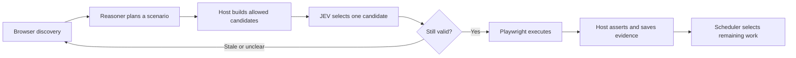

# QASE agent architecture change

The first change is a controlled decision loop for one public QA journey. QASE should discover the relevant controls, plan **Home → Solutions → Pricing**, choose each action, and prove the expected outcome with browser evidence. The dev demo target remains **Tuesday, 17 November 2026** if the JEV gateway test and baseline pass on schedule. The **Friday, 20 November** checkpoint covers one visual check.

## What changes

Today, QASE already discovers features, schedules work, invokes browser tools through the SDK, and verifies completed scenarios against saved assertions. JEV already classifies observations and can rank observed routes as advice. The missing piece is a validated JEV choice connected to execution for a specific pending scenario step.

| Component | Responsibility after the change |
| --- | --- |
| Existing discovery | Identify controls actually observed on the current page and save their IDs and source evidence. Discover new features as new pages load. |
| Reasoning model | Define the objective, choose the scenario, and record the expected behavior and its source. Replan when the product changes or the expected result is unclear. |
| JEV | Choose one of the host-provided candidates for a routine step. Each candidate identifies one allowed action and one observed control. The response is a candidate ID or `unknown`. |
| QASE host and Playwright | Check that the chosen candidate still matches the active page, scenario, and authorization. Execute through the existing browser tool. Assert the result and save the evidence. |
| Run UI | Show the discovered step, expected result, observed result, browser, and evidence link. Explain blocked or unverified outcomes where the user can act on them. |

## The first decision contract

- The host creates a short candidate list from the active page and pending step. For the first proof, allow only read-only in-scope navigation. A candidate includes an opaque ID, action, control label, and observed destination. Use the current page state and discovery receipt to resolve its locator on the host.
- Reuse the existing JEV `choice` request and response validation. Include `unknown` as a choice. For one unambiguous host-verified candidate, execution can proceed without spending a model call. The proof should include a page with at least two plausible candidates so we can demonstrate an actual JEV decision.
- At execution, revalidate the run, pending step, page state, and candidate. A stale result triggers one fresh observation. An unknown or invalid result becomes an explicit execution gap or returns to the reasoner for a new plan.
- Record the expected destination and visible heading separately. The heading expectation comes from the fixture specification or an approved user requirement. A page returning HTTP 200 cannot pass the heading check on its own.
- Keep a link from the step to the decision, browser action, assertion, and evidence. Record which model made the choice, timing, and verified token usage using the existing accounting. Preserve completed assertions on resume.

## Build sequence and acceptance

| Order | Work | Exit condition |
| --- | --- | --- |
| **1. Baseline and JEV spike — half a working day** | Confirm the existing hybrid launcher and record the same fixture journey with current timing and token counters. Use the existing qualified JEV connection to test one candidate choice. | JEV selects the expected candidate from a bounded list and returns a valid usage receipt. If it cannot, record the gateway or decision failure and separate the browser-only demo from the JEV claim. |
| **2. Connect one step — one working day** | Add the candidate chooser to the existing QA route execution behind an opt-in for new demo runs. Use the existing discovery receipt, scenario scheduler, browser policy, and assertion writer. | A valid choice reaches Playwright. A wrong or stale ID reaches no browser action. The report displays the assertion and evidence. |
| **3. Complete and verify the demo journey — half to one working day** | Run the three-page journey against healthy and seeded-defect fixtures in separate Chromium and Firefox runs. Expose the results in the Start → Running → Results UI. The UI contributor can work from the existing prototype while the agent track runs. | Healthy fixtures pass. The wrong heading or destination fails even with HTTP 200. Browser outcomes remain separate, completed checks survive resume, and the demo shows measured time, tokens, and verified assertions. |
| **4. Extend after the first proof** | Add one visual check for the Friday checkpoint, then qualify broader browser/device execution, signed-in staging journeys, and other requested coverage as separate changes. | Each extension has a working and defective fixture and its own evidence. Set production timing after the Linux regression, image verification, and staging runs pass. |

Existing runs retain their saved execution strategy. The first prototype does not require a database migration if the existing scenario and evidence records carry the results. Prove the two-browser comparison with separate runs before expanding it into a single concurrent launch.

## Implementation map

- **Discovery and planning:** `server/qaApplicationDiscovery.js` and `server/qaScenarioLedger.js` already bind plans to observed features and distinguish approved expectations from hypotheses.
- **Decision:** `server/hybridModelRouter.js`, `server/jevClient.js`, and the existing advisory ranking in `server/hybridRouteExecution.js` provide the starting point for bounded selection and model accounting.
- **Execution and reporting:** keep the scheduler, the existing SDK browser dispatcher, browser policy, and the independent gate in `server/qaCompletionGate.js`. Have the UI consume their saved assertions.
- **Verification:** extend the isolated discovery and scheduler fixtures. Compare the old and new paths on the same scope, browser settings, and runtime budget. Report the actual measurements before setting a speed target.

The next implementation task is **one JEV-selected link from a real page snapshot to a verified destination**. Time-box that spike and use its result to confirm or revise the demo estimate.
