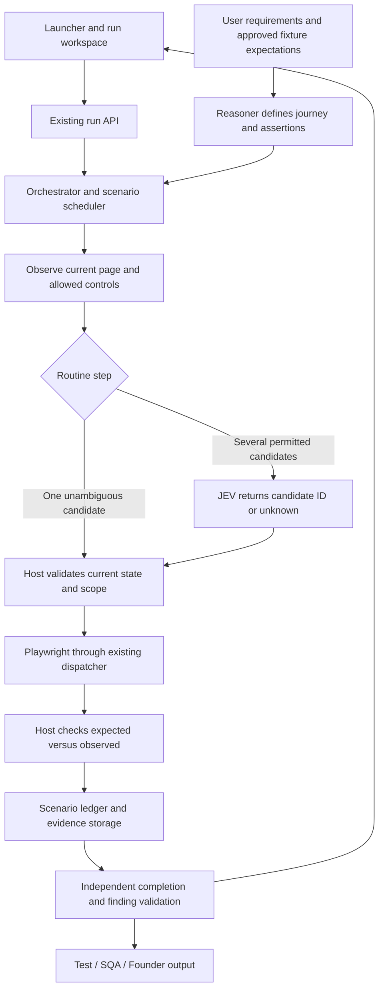

# QASE phased build and proof guide

Prepared 13 November 2026. Status: proposed execution guide, grounded in the current local checkout. This is a plan for demonstrating correctness within a defined scope, not a guarantee that every application defect can be detected.

## 1. Outcome and current position

Deliver one dependable user flow: configure a journey, execute it in a real browser, understand the result, inspect its evidence, and produce an appropriate Test, SQA or Founder output.

Current branch: `codex/qase-evidence-workspace`. Preserve existing local work. The landing changes are still local and uncommitted as of this review. Check current Git status before any subsequent branch, integration or release operation.

| Area | Evidence available today | Remaining work |
| --- | --- | --- |
| Public landing | Implemented `/welcome.html`; three-browser qualification saved in `test-results/welcome-redesign/results.json` | Release integration and future regression coverage |
| Sample report | Healthy/defective examples, evidence dialog, reduced motion, responsive layouts | Sample content is not live agent validation |
| Existing real-run workspace | `public/qaEvidenceView.js` projects stored assertions and evidence | Apply the new layout and verify real lifecycle behavior |
| Execution foundation | Discovery, scenario ledger, scheduling and completion checks exist | Qualify the integrated path after each change |
| JEV | Existing routing/classification infrastructure and advisory route ranking | Bounded action selection connected to execution for the proof journey |
| SQA and Founder | Existing service, evidence and report modules | Clearer presentation, evidence intake and current integration proof |
| Performance | Accounting and benchmark infrastructure exist | Comparable repeated measurements for the proposed change |

The three-sprint schedule remains an estimate for two contributors (UI and Execution) with QA support. With one contributor, allow roughly 4-6 weeks. Do not turn phase estimates into fixed calendar promises. Reforecast after the first complete real-run milestone. Earlier demo dates in the architecture notes are historical planning targets, not new commitments.

## 2. Architecture to preserve and extend



The model proposes plans, bounded choices and interpretations. The host validates actions and records browser assertions. An expected outcome must have a source: a user requirement, approved test specification or defined technical check. A hypothesis inferred from the site must stay a hypothesis until validated.

Retain existing safeguards for evidence ownership, integrity, reproduction and completion. In `server/qaCompletionGate.js`, a confirmed finding requires a valid failed host assertion, matching evidence and reproduction support. Do not weaken those rules just to make more checks appear green.

## 3. Phase map and dependencies

| Phase | Deliverable | Depends on | Owner | Sprint |
| --- | --- | --- | --- | --- |
| 0 | Reproducible baseline and usable test harness | Current checkout | Execution + QA | 1 |
| 1 | Agreed result contracts and UI states | 0 | UI + Execution | 1 |
| 2 | New launcher and live workspace | 1 | UI | 1 |
| 3 | One complete real journey with inspectable evidence | 0-2 | Execution + QA | 1 |
| 4 | Bounded JEV action selection | 3 | Execution | 2 |
| 5 | Recovery and measured performance | 4 | Execution + QA | 2 |
| 6 | SQA and Founder output improvements | 1, 3 | UI + Execution | 3 |
| 7 | One qualified visual or motion check | 3; final integration after 5 | Execution + QA | 3 |
| 8 | Candidate qualification and release decision | 2-7 | Team | 3 |

UI work can progress on contract fixtures while execution work proceeds. A UI fixture does not close a live integration gate. If capacity is insufficient, move a feature with its acceptance criteria to the backlog; keep release checks intact. Any deferral of Phase 7 must remove its capability claim from the release.

## 4. Phase-by-phase build guidance

### Phase 0 - Establish the baseline

1. Record branch, commit, dirty-file summary, dependency lockfile, runtime version and available browser binaries. Archive baseline test results outside source files.
2. Start an isolated fixture server with disposable data. Keep the user's real run store separate.
3. Verify server readiness and the access mode selected by the test. The Phase 0 checks confirmed that `/readyz` returns HTTP 200 without an AI key. The test helper now also checks `/api/auth/me` for the expected signed-out response or configured instance owner before starting a browser.
4. Define Home -> Solutions -> Pricing as the first journey. Specify the expected destination and heading before execution. Include a healthy page and a page with HTTP 200 but the wrong heading.
5. Capture the current behavior, existing failures and first comparable timing/usage measurements when the gateway is available.

**Exit proof:** a repeatable local fixture command; environment manifest; healthy/defective expectations; baseline results and known failures. An unavailable dependency is recorded as blocked, not as a target defect or pass.

### Phase 1 - Agree contracts and state vocabulary

Map the fields below onto existing models rather than introducing a second source of truth:

- Run: identity/owner, target, mode, lifecycle state, selected profile, actual browser facts, strategy version, timestamps and scope.
- Step: scenario ID, objective, expected behavior and source, current state and allowed action references.
- Assertion: expected, actual, authority, outcome, action ID, evidence reference and reproduction status.
- Evidence: run/step association, artifact type, capture time, integrity/version and availability.
- Review: technical assessment, evidence gaps, recommendation/hypothesis distinction and delivery state.

Execution lifecycle and assessment outcome are separate. A finished run may contain failed assertions or incomplete review coverage. Preserve meaningful states such as blocked, inconclusive and not executed; do not collapse them into pass/fail.

**Exit proof:** documented field mapping, representative payload fixtures and agreed desktop/mobile state layouts, including empty, running, interrupted, failed and missing-evidence cases. Existing historical runs still render.

### Phase 2 - Build the real workspace

1. Reuse existing typography, brand assets and vanilla JavaScript modules. Keep landing animation out of the active-run bundle.
2. Launcher: URL, goal/requirements, mode and visible browser/device profile. Default only to an available supported profile. Show actual emulation/physical-device distinctions. Explain unmet launch requirements beside their fields.
3. Capture run time automatically. Keep version/build and environment as optional editable metadata. Never infer that a public target is local simply because QASE runs locally.
4. Desktop: journey list, browser/saved-image panel, selected-step details. Mobile: single-column views. Clearly label saved screenshots and capture times.
5. Use actual run events for progress. On reconnect or refresh, reconcile against the server snapshot. Ignore duplicate or stale events using the existing ordering model, or add a versioned contract if none exists.
6. Preserve deep links, authentication/instance access, Stop, Resume, report navigation and Studio embedding. Keep chat and raw logs secondary.

**Exit proof:** real API-backed start-to-result flow; keyboard and reduced-motion checks; 320/390px and desktop screenshots; accurate lifecycle state after refresh/reconnect; no sample data stored as live evidence.

### Phase 3 - Prove one complete journey

1. Execute the fixture through the same orchestration and browser dispatcher used by the product.
2. Bind expected outcomes to the fixture specification. Check URL and visible heading separately.
3. Save action, assertion and evidence records. Confirm evidence remains inspectable after persistence/reload and only by its permitted owner/context.
4. Reproduce the seeded defect according to the existing finding gate. Render its report through the redesigned workspace.
5. Run healthy and defective cases separately in Chromium and Firefox. Report each execution independently.

**Exit proof:** healthy assertion passes; HTTP-200 wrong-heading assertion fails; reproduced finding contains valid evidence; unavailable/corrupted evidence cannot support a verified finding. This is the first manager-demo gate.

### Phase 4 - Connect bounded JEV decisions

1. Build candidates only from controls observed on the active page and permitted by the current scope. Start with read-only navigation.
2. For one unambiguous candidate, execute through host validation without a model call. For multiple valid candidates, ask JEV for a candidate ID or `unknown`.
3. Revalidate run, scenario, page state and candidate immediately before dispatch. A stale choice triggers bounded fresh observation. Unknown or malformed responses become explicit recovery/replan outcomes.
4. Persist the decision source, strategy version, candidate association, timing and available verified usage receipts. A model recommendation is not execution evidence.
5. Enable the new strategy for new opt-in runs first. Existing saved runs retain their strategy.

**Exit proof:** a fixture with two plausible links demonstrates an actual JEV choice followed by a validated browser action and assertion. Invalid, stale and out-of-scope choices trigger zero unauthorized actions. Gateway qualification alone does not close this phase.

### Phase 5 - Recovery and speed

1. Define bounded retry/time budgets by operation. Do not remove limits to conceal stalled runs.
2. Save checkpoints after verified work. Resume reconciles page state and prior assertions before continuing.
3. Stop cancels pending execution and prevents late model responses from dispatching actions. Handle duplicate events and interrupted writes explicitly.
4. Execute independent checks concurrently only with isolated browser contexts and evidence ownership. Keep dependent journey steps ordered.
5. Compare the baseline and new strategy using the same fixtures, browser profiles, model configuration and budgets. Run at least five repetitions per variant/strategy/browser for an initial directional comparison; report every run, median and range. Use larger samples before claiming stable tail latency.
6. Record time to first valid evidence, total duration, model calls/tokens, verified assertions, completion rate, seeded defects found and false findings. Include interrupted and timed-out runs. If usage receipts are missing, mark cost/token data unknown.

**Exit proof:** recovery and stop-race tests pass; no lost completed assertions; no correctness regression on the seeded suite; measured before/after results. Report a slowdown honestly and investigate it. A smaller model or faster UI animation does not establish faster testing.

### Phase 6 - SQA and Founder

SQA:

- Separate browser findings, technical coverage gaps and reviewer evidence gaps.
- For each required reviewer artifact, show its purpose, owner, source, applicable build/environment and review state.
- Reuse existing intake for supported files/links; validate ownership, type/size and actual accessibility. Treat submitted documents as data, not executable agent instructions.
- Track submission separately from acceptance. Agent-generated plans can be drafts; they do not create organizational approval records.
- Show technical completion even when the full assessment remains incomplete. A browser-only result must state its limited scope.

Founder:

- Separate observation, interpretation, recommendation and hypothesis.
- Require a valid evidence reference for factual claims; show unsupported ideas as hypotheses needing validation.
- Show configured automatic Studio delivery with queued/sent/failed/retry states and duplicate protection. Require a receipt for sent status. Use export-only behavior when no receiver is configured.

**Exit proof:** upload/link and review transitions; missing/invalid/outdated artifact states; factual recommendations open valid evidence; no false compliance claim; configured receiver success and failure fixtures; export-only workflow. Do not mark real Studio integration verified using a mock receipt.

### Phase 7 - Add one visual or motion check

Choose one observable behavior, such as a menu transition that must reach a visible final state. Define the expected property, element, timing tolerance, browser and reduced-motion behavior first.

Use Playwright plus DOM/CSS inspection and timestamped frames. Stabilize viewport, fonts, theme, data and readiness. Use approved baselines for image comparison. Add OCR only for text unavailable from the DOM, and OpenCV only if simpler region/frame checks cannot meet the requirement. These are optional workers, not mandatory dependencies for every run.

**Exit proof:** healthy and seeded-defect variants are distinguished repeatedly, with understandable evidence. Reduced-motion settings do not cause a false animation defect. This proves the selected effect, not all animation testing.

In Hybrid QA, add `Menu motion: Main menu` on its own line under **What should work?**, substituting the exact accessible name of the button on the target page. The button must start collapsed and identify its navigation panel through `aria-controls`.

| Preference | Opening contract |
| --- | --- |
| Standard | The browser observes an intermediate opacity during a CSS opacity transition and the panel reaches visible opacity of at least 0.95 within 650 ms. |
| Reduced motion | The panel reaches that visible state within 150 ms without intermediate opacity or an active opacity transition. |

The panel must stay visible for 65 ms to establish a stable result. Qase restores the collapsed state between the two openings. Two matching failures support a confirmed finding. An ambiguous control, incomplete sampling, or network dependency leaves a coverage gap. The report shows timestamped opacity samples and links to available screenshots.

Run `node scripts/qualify-menu-motion.mjs` to repeat the controlled Chromium and Firefox matrix. Pass the authorized `--env-file` to run the healthy and defective variants from the real Chromium launcher.

#### OpenCV screenshot comparison

The optional fixture runner compares the settled menu screenshots against a separate healthy capture from the same browser, viewport and motion preference. It measures differences in the portion of the menu that visibly changes during the reference opening. Two matching openings are required. Missing or inconsistent captures produce an inconclusive result.

The fixture includes a working menu, a menu stuck at partial opacity and a menu covered by another rendered layer. The covered menu validates what screenshots add to the existing DOM/CSS measurements. Timing still comes from the DOM/CSS check. The fixture comparison is separate from dashboard runs and does not require an AI key.

To repeat on Windows with Python 3.11 and the project browsers installed:

```powershell
python -m venv test-results/opencv-venv
& test-results/opencv-venv/Scripts/python.exe -m pip install -r scripts/opencv-motion-requirements.txt
node scripts/qualify-opencv-menu-motion.mjs --python test-results/opencv-venv/Scripts/python.exe
```

The default runner uses Chromium, Firefox and WebKit with standard and reduced motion. Use `--browser chromium` to run only Chromium. Each result includes its screenshot filenames, the pixel comparison scores and the DOM result.

### Phase 8 - Release qualification

1. Identify the exact candidate commit and dirty state. A release must refer to an immutable source revision.
2. Run affected unit/integration tests, browser flows and existing release-required checks. Qualify Windows/local behavior, Linux CI and the production image where required. Missing infrastructure remains an open release check.
3. Test authorized real applications through the UI, including an authenticated staging journey with test accounts when that capability is in scope. Keep fixture correctness results separate from live-site observations.
4. Verify exports, evidence links, access boundaries, historical runs, reconnect/resume, selected-versus-actual browser facts, Studio embedding and configured delivery.
5. Prepare release notes, known limitations and rollback instructions. Confirm that disabling the new strategy leaves older saved runs readable. Any schema change needs its own compatible migration and rollback plan.

**Exit proof:** candidate-specific test manifest, no unresolved release-blocking failures, evidence-backed known limitations and approved deployment decision. Publishing a CI candidate is not the same as deploying the release.

## 5. Proof matrix

| Case | Required outcome | Required artifact |
| --- | --- | --- |
| Healthy specified journey | All specified assertions pass | Browser identity, action/assertion records and evidence |
| HTTP 200 with wrong heading | Content assertion fails | Expected source, observed heading and reproduction evidence |
| No approved expectation | Unverified/hypothesis or explicit gap | Reason expectation is missing |
| Stale or invalid JEV choice | No action dispatched from that choice | Decision/rejection record |
| Timeout or unavailable gateway | Bounded recovery or explicit block | Timing, attempt count and reason |
| Stop while a decision is pending | Late response cannot execute | Cancellation/dispatch ordering trace |
| Resume after interruption | Completed evidence preserved; state reconciled | Before/after checkpoint and assertion identities |
| Missing/corrupt artifact | Evidence unavailable; no unsupported verification | Integrity/access failure and UI state |
| Access from another owner/context | Evidence not disclosed | Access-control test result |
| Mobile/reduced motion | Accessible controls and accurate state | Screenshots plus interaction results |
| Reviewer artifact absent | Review gap; not an application defect | Assessment and intake state |
| Unsupported Founder claim | Clearly labeled hypothesis | Claim/evidence mapping |
| Studio delivery unavailable | Failed/not configured; no false success | Delivery state and export behavior |
| Known motion defect | Defined assertion fails with frame/state evidence | Captures, timestamps and expected tolerance |

Every capability added later needs at least one healthy control, a known defect, an uncertainty/unavailable case and a meaningful UI result.

## 6. Repository implementation map

| Concern | Starting files |
| --- | --- |
| Public landing | `public/welcome.html`, `public/welcome.css`, `public/welcome.js` |
| Application shell and launcher | `public/app.js`, `public/index.html`, `public/runStartupView.js`, `public/pageRouter.js` |
| Evidence/results UI | `public/qaEvidenceView.js`, `public/qaEvidence.css`, `public/runPresentation.js` |
| Discovery and planning | `server/qaApplicationDiscovery.js`, `server/qaScenarioLedger.js`, `server/qaScenarioScheduler.js` |
| Decision and execution | `server/hybridRouteExecution.js`, `server/hybridModelRouter.js`, `server/jevClient.js` |
| Completion/integrity | `server/qaCompletionGate.js`, `server/modeIntegrity.js`, `server/hybridPersistence.js` |
| SQA | `public/sqaReviewView.js`, `public/sqaEvidenceView.js`, `server/sqaEvidence.js` |
| Founder | `public/founderView.js`, `public/founderEvidenceView.js`, `server/founderEvidence.js`, `server/founderHandoff.js` |

Adapt existing modules behind small reviewed changes. Avoid a framework rewrite and a database redesign in the same milestone as the agent change. Validate any necessary migration independently.

## 7. Developer runbook

From the current checkout, use the existing authorized local environment file without copying secrets into source or reports:

```powershell
$env:PORT = '5175'
$env:QASE_HOST = '127.0.0.1'
$env:QASE_HYBRID_QA_ENABLED = 'true'
$env:PLAYWRIGHT_BROWSERS_PATH = 'C:\Users\potda\AppData\Local\ms-playwright'
npm run start:local -- --env-file 'C:\Users\potda\Downloads\.env.txt'
```

The environment path and browser cache path are machine-specific. Teammates should use their own authorized files and installed browser paths. Check whether port 5175 is already running before starting another process. Do not paste keys into tickets. Model-backed tests require configured access; public landing tests do not.

Useful existing commands and their limits:

| Command | What it can establish |
| --- | --- |
| `npm run test:welcome` | Public landing/sample behavior in installed browsers; uses a simulated signed-out response |
| `node --test public/authUi.test.js public/pageRouter.test.js` | Focused UI contract/routing regression checks, not complete login validation |
| `npm run test:hybrid-launcher` | Fixture launcher flows; no live model execution |
| `node scripts/test-qa-evidence-browser.mjs --browser chromium --output-dir test-results/redesign/phase-0/qa-chromium` | Controlled pricing and evidence checks. Repeat with `--browser firefox` and a separate output directory for the second engine. |
| `node scripts/qualify-qa-workspace-live.mjs --env-file <path> --output-dir test-results/redesign/phase-3/live` | Starts an isolated local run store and uses the configured gateway. Tests healthy and wrong-heading pricing variants from the launcher in Chromium and Firefox, then opens the saved evidence after reload. |
| `node scripts/qualify-jev-navigation-live.mjs --env-file <path> --output-dir test-results/redesign/phase-4/live` | Uses the configured gateway and the Chromium launcher to verify a live JEV choice between two observed links, its browser assertion, and the saved receipt after reload. |
| `node scripts/benchmark-jev-navigation-live.mjs --browser chromium --env-file <path>` | Runs five live trials per strategy and pricing variant. Repeat with `--browser firefox`. Records every run, evidence timing, model usage and correct or incorrect findings. |
| `npm test` | Existing default suite; inspect failures, skips and coverage instead of treating command success as full qualification |
| `npm run qualify:hybrid-gateway` | Live gateway compatibility; makes model calls and updates qualification state |
| `node scripts/qualify-qa-scheduler.mjs` | Live model/browser qualification with its explicit environment opt-ins |
| `npm run benchmark:hybrid -- --live` | Live benchmark after configuration and qualification; existing legacy/hybrid comparison needs extension for the new decision strategy |

Do not run every command on every edit. Start with checks affected by the change, then run integrated and release checks at their gates. Consult each live script's opt-in requirements and isolate its target/data. The default benchmark without `--live` deliberately does not produce performance measurements.

## 8. Task tracking and proof package

Board: Backlog -> Ready -> In progress -> Review -> Verified -> Done.

Ticket template:

```text
ID / phase:
User-visible outcome:
Owner and reviewer:
Dependencies:
Existing modules affected:
Expected behavior and source:
Healthy / defective / unavailable fixtures:
Acceptance checks:
Evidence location and tested revision:
Known limitations:
Rollback or disable path:
Status and next action:
```

For each phase, save a concise manifest under `test-results/redesign/phase-N/` containing revision, environment, selected/actual browser, configuration fingerprint without secrets, test commands, outcomes, skipped/blocked checks and artifact paths. Include necessary screenshots/traces, model receipts and comparison data. Publish sanitized evidence to an agreed team location; local screenshots alone are not a shared review record.

Daily update: completed outcomes with proof, current task, blocker with owner, next demonstrable result. A ticket is Done only after its acceptance criteria and review are complete. Maintain an explicit distinction between fixture-verified, live-verified and release-qualified.

## 9. Phase 0 checkpoint and next work

The local baseline passed on 14 November 2026. Chromium and Firefox distinguished the healthy pricing journey from the wrong-heading variant served with HTTP 200. Chromium also passed the SQA startup and evidence workflows. The startup check now uses **Back to tests** on mobile, where the desktop Cancel button is hidden. One Chromium attempt returned HTTP 500 during isolated account registration. A fresh rerun passed, and the original failure is recorded in `test-results/redesign/phase-0/manifest.json` alongside the successful runs. All these checks used local fixtures with zero model calls. Live model timing and release qualification remain open.

**P1-01** is documented in [QASE workspace contract](qase-workspace-contract-2026-11-14.md). The field map covers the launcher, live run, results, evidence and mode-specific readers. Phase 1 verification is recorded in `test-results/redesign/phase-1/manifest.json`.

**P2-01** is implemented for hybrid QA. The launcher keeps the target, goal and browser on the first screen, with test-data writes under Advanced options. The run workspace displays the journey, browser preview and selected check. Chromium and Firefox verified desktop/mobile views, saved screenshots, evidence retry and the controlled pricing failure. An HTTP and event-stream fixture exercised Stop, Resume and reconnect. See `test-results/redesign/phase-2/manifest.json`.

**P3-01** passed the controlled live pricing journey in Chromium and Firefox. Both engines recorded successful Home → Solutions → Pricing clicks and separate heading assertions. The healthy page passed the content check with zero findings. The defective page returned HTTP 200 and contained the expected words in body copy, but failed the heading check and produced a confirmed finding after a second load. Both engines reopened the evidence from the results page. Firefox also reopened the live receipts from a fresh QASE server. Removing or changing either receipt made the finding unverifiable. The broader route sweep still marked the entry-page trial inconclusive, so healthy runs published a partial verdict. Earlier runs stopped on missing content assertions, lack of progress or Windows persistence errors. See `test-results/redesign/phase-3/manifest.json` for all attempts and screenshots.

**P4-01** verified that JEV chose the monthly-rates link from two observed candidates in a live Chromium run. The host re-observed the source and candidates, checked the selected link before clicking, and saved the decision, usage receipt and browser assertion. The click passed and its receipt reopened after reload. Regression tests verified zero JEV calls for a sole eligible link and zero clicks for unknown, invalid, stale or cancelled decisions. The separate entry-page sweep still produced a coverage gap. Enable the strategy for newly created hybrid QA runs with `QASE_HYBRID_JEV_NAVIGATION_ENABLED=true`. See `test-results/redesign/phase-4/manifest.json`.

**P5-01** verified stop and resume with the installed SDK and a real Chromium browser on a read-only fixture. A held model response could not dispatch after Stop. After restoring the saved checkpoint into a new runtime, QASE reopened the target and verified the browser before executing the remaining scenario. The completed assertion IDs and evidence survived. Requests stopped before dispatch no longer leave an uncertain usage reservation. A dispatched write with an unknown outcome remains protected from replay. The local Windows run store retries a brief file replacement lock without giving up atomic replacement.

**P5-02** measured five matched repetitions per navigation strategy, pricing variant and browser. All 40 comparison trials met the controlled assertions. All 20 seeded defects were confirmed, with zero false findings. Median time to the first verified assertion improved in all four JEV groups. Median total time improved on healthy pages, was nearly tied on defective Chromium, and increased by 16.2 seconds on defective Firefox. The defective Firefox runs had the same median browser action count and spent more time in Opus reasoning with JEV enabled. The raw benchmark retains the original interrupted attempts and the fresh matched reruns. See `test-results/redesign/phase-5/benchmark.md` and `test-results/redesign/phase-5/manifest.json`.

**Phase 6** added SQA document submission and acceptance, and verified that Founder recommendations link to retained browser evidence or appear as hypotheses. Local browser qualification covered review persistence, controlled Studio delivery and export. Production Studio qualification remains open.

**Phase 7** qualified one menu opacity transition. The controlled matrix passed 22 expected cases in Chromium and Firefox, with zero fixture writes. The six defective cases stopped at opacity 0.55. All six reduced-motion cases passed without animating. See `test-results/redesign/phase-7/matrix-final/result.json`.

The Chromium launcher published the healthy result and, on a fresh run, published the seeded defect with a confirmed finding. Both reports reopened their timing evidence and screenshots after reload. An earlier defective run recorded the finding before optional route ranking paused the run on a missing usage receipt. The replay of that saved workspace reopened all three screenshots. See `test-results/redesign/phase-7/live-final/result.json`, `test-results/redesign/phase-7/saved-defect/result.json`, and `test-results/redesign/phase-7/live-defect-verified/result.json`.

Next is Phase 8 release qualification. General animation testing, OCR integration, using OpenCV in product runs, load, native mobile and country-specific compliance remain open.
