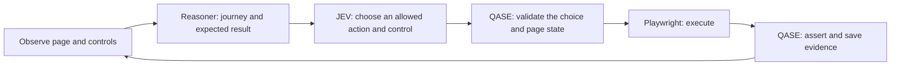

# QASE demo and UI plan

**Demo target: Tuesday, 17 November 2026.** Show one browser journey that QASE discovers, verifies, and explains. **Visual check target: Friday, 20 November.** Show one animation or rendering defect that QASE can catch with evidence. These are dev checkpoints, assuming two contributors starting Friday, 13 November, working JEV access, and a normal weekend. With one contributor, budget 5–7 working days for the first checkpoint. Set production timing after CI and staging verification.

## 1. Establish the baseline — Friday, 13 November

- Use the combined release at `ac63b72`. Preserve the existing discovery, test scheduler, Playwright bridge, and evidence records.
- Reuse a controlled public-page fixture to verify discovery and execution. Capture the current launcher on desktop and list where users lose context or see repeated information.
- Define the demo journey as Home → Solutions → Pricing. Keep the expected destination, expected page content, actual result, and browser evidence for each step. Keep the same scope and browser settings when comparing time and tokens.

Initial verification: both native SDK and real-browser discovery fixture tests passed, including navigation, local forms, and responsive execution. The isolated launcher checks for SQA and Founder also passed. The older hybrid launcher script stopped because it expects **Change browser** to expand Advanced options. The current handler switches to the browser/device picker. Verify that picker behavior in the new launcher test. The launcher fixture screenshot is under `test-results/qa-proof-20261113/current-launcher/desktop.png`. The discovery fixture uses scripted decisions. Live JEV routing, runtime, and token measurements still need a same-scope baseline.

The clickable design preview is `test-results/qa-proof-20261113/prototype.html`. It uses sample data, with the failed step and its expected and observed results on one screen. Chromium verified the flow from Start to Running to Results, opening the sample evidence, focus on screen changes, and 390px layout without horizontal overflow. Desktop and mobile previews are in the same directory.

## 2. Prove one journey and redesign the run flow — Monday–Tuesday, 16–17 November

**Agent track.** Discover only real, in-scope controls. Let the reasoning model define the test objective and expected result. Let JEV select an allowed action and observed element where it can. Playwright executes the selection, and the host verifies and saves the outcome. Preserve the existing scope, permission checks, and evidence boundaries. Reuse the same verified plan for Chromium and Firefox. Flag any browser-specific differences in the report.

### Architecture change for this checkpoint

The current branch already discovers features, schedules work, and runs browser checks through the SDK. Its JEV router classifies saved observations and provides advisory route ranking. The proposed change adds a bounded JEV decision **before** a browser action for this journey. It reuses the existing execution and reporting pipeline. See [the engineering plan](qase-agent-architecture-plan-2026-11-13.md) for the decision contract, build sequence, and acceptance checks.

1. **Discover.** Save the page state and IDs for observed controls. Search or sign-in enters the plan only if observed in scope or explicitly required. Report an explicitly required but unavailable feature as a gap.
2. **Plan.** The reasoner defines why each step exists and what outcome to check. For Pricing, record the expected destination and a visible heading or other requirement. Use the reasoner again when a new page changes the plan or the expected result is unclear.
3. **Choose.** Give JEV the current objective, allowed action choices, and observed control IDs. Accept a bounded action/ID pair or a request for clarification. Verify working gateway access and response shape on the first navigation step before expanding the journey.
4. **Execute and verify.** The host validates the choice against the current page and run scope before Playwright acts. A stale choice requires fresh observation. Save the expected and actual result, per-browser outcome, evidence ID, action time, and model usage. Resume from the last verified checkpoint when possible.

Show in the demo which decisions JEV made and which assertions the browser verified. Run Chromium and Firefox as two isolated executions of the same plan. A single multi-browser launch with concurrent execution and aggregated results is a follow-up to qualify. If the gateway or decision contract blocks the JEV experiment, report that status separately from a browser-only proof.

**UI track.** Design and implement three states using the existing QASE assets and APIs.

| Screen | Primary job | Layout |
| --- | --- | --- |
| Start | Enter the URL and launch the right mode | Single column. URL first, mode and browser beside each other on desktop, optional goal under Advanced. One Start action. |
| Running | Understand progress and intervene if needed | One status, the current step, and a short journey list. Live preview and raw activity expand on demand. Interrupted runs show the saved step and recovery action. |
| Results | Decide what to fix | A result summary above the journey. Each row shows **Expected → Observed** and links to its evidence. The failure gets the strongest visual emphasis. Browser details and logs are secondary. |

Use the existing Geist typography and QASE blue. Use ink `#14213D` for text, paper `#F6F8FC` for the workspace, white `#FFFFFF` for the report, QASE blue `#315DE7` for actions, green `#167253` for passed evidence, and red `#A43634` for failed evidence. Keep the journey and evidence left aligned. Stack fields and evidence rows on narrow screens. Use text labels alongside status colors and preserve visible keyboard focus. The visual emphasis belongs on expected versus observed results. Put model names, run tokens, and configuration details where a reviewer can find them without interrupting launch.

**Acceptance.** In both browsers, the healthy path passes and a controlled wrong destination or missing required heading fails. Only an executed assertion can pass. The run surfaces its failing step and source evidence. A reviewer should be able to identify what failed and why directly from Results. Compare wall time, model tokens, and completed assertions against the same baseline. Inspect desktop and mobile layouts and verify Start, Stop, Resume, and report navigation.

## 3. Add one visual proof — Wednesday–Friday, 18–20 November

- Use Playwright with DOM/CSS inspection to verify one example such as a rotating headline or a transition that must reach a visible final state. Capture a few frames around the change and record timing.
- Use a controlled healthy and defective variant. Show the observable difference, such as a headline that stops rotating or a brief wrong-theme frame. Preserve screenshots and expected/observed facts.
- Add OpenCV only if the frame comparison needs more than simple pixel or region comparison. Use OCR when text exists only in rendered pixels. Start with one effect and one known defect to keep the result repeatable.

## 4. Release verification

Resolve the Linux browser-authentication regression, rerun the broader workflow through image verification, and test the candidate on staging. Keep broad animation coverage, device expansion, and automatic reviewer evidence imports in the follow-up scope. Use the dev demo to agree which comes first.

## Other gaps and when we address them

| Gap from the demo | Delivery decision |
| --- | --- |
| Generic plans, repeated actions, vague passes | First demo. Plan from observed features, reuse completed work within the same browser and page state, and show the assertion behind each result. |
| Animation, layout overlap, theme flash | First visual checkpoint covers one effect with a healthy and defective fixture. Add other visual checks after reviewing that evidence. |
| Broader browser and device coverage | First demo compares two browsers on the same plan. Qualify a combined browser/device run and its result summary after that. |
| External navigation and embedded resources | Follow-up. Show out-of-scope destinations separately from resources needed for rendering, and verify the distinction on a controlled fixture with existing authorization boundaries. |
| Signup, email verification, signed-in journeys and role checks | Follow-up on authorized staging fixtures with test accounts and approved test email infrastructure. Define expected outcomes per role and record what remains outside scope. |
| SQA and Founder reliability | Keep their current workflows while revising QA execution. Recheck their launch and reports before release. Track reviewer evidence intake, unfinished SQA browser checks, and live Founder accuracy as separate follow-ups. |
| Speed and token usage | Compare the same journey and browser settings before and after. Measure elapsed time, model calls, tokens, repeated actions, and assertions completed. Publish the measurements before setting a speed target. |

## Optional Stitch design brief

Stitch is useful for exploring the three screens and collecting design feedback. Use this brief with synthetic results. Use the selected design as a reference for the existing app components and behavior.

> Design a desktop and mobile QA workspace for QASE, used by product owners and testers. Show three states: start a QA run, follow the running test, and read the results. Use a single public website journey, Home → Solutions → Pricing. The results should make the expected URL and heading, actual result, browser, and evidence visible with minimal scanning. Show a sample pricing-heading failure on Firefox and a pass on Chromium. Use the QASE palette and Geist style above. Keep URL, mode, browser, and Start prominent. Collapse raw logs, preview, model details, and advanced settings. Use meaningful status labels, visible focus, and clear mobile stacking. Design the actual product screens rather than a marketing landing page.

## Manager update

> We’re proving one complete QA journey before expanding scope. The architecture change is to use the reasoning model for the plan, JEV for bounded action choices, and Playwright for verified execution. By Tuesday, we’ll aim to show the same journey in two browsers, with a clear pass, a controlled failure, and a redesigned flow from Start to Results. By Friday, we’ll aim to show one visual defect the agent catches with evidence. We’ll report measured speed and token use once the live run is comparable, and set a production date after CI and staging verification.
